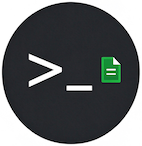

# Visual Paradigm CLI

[English](README.md)

当前版本：**天字一号甲**（1.1.1）


## 是什么
基于 Visual Paradigm 的一组命令行工具(CLI)，目前核心功能是将模型导出成 PlantUML 形式。 

## 为什么

- 为了让 AI 写程序，要向 AI 把业务概念或设计逻辑讲清楚
- 对于复杂系统，需要通过 UML 模型才能讲清楚
- Visual Paradigm 是目前比较好的可免费使用的 UML 建模工具
- AI 不容易直接读 Visual Paradigm 的建模产物
- AI 容易理解文本形式的 PlantUML
- PlantUML 本质上是绘图工具，不是建模工具，对于复杂建模局限较大
- 因此，可结合两者优点，先用 Visual Paradigm 建模，再利用命令行导出成 PlantUML，作为 AI 编程的输入
- 容易教会 AI 操作 CLI，从而形成基于模型的 AI 开发工作流

## 怎么用

### 安装
1. 在 Github Releases 中**下载 `.zip` 文件**
2. **打开 Visual Paradigm**，切换到 **Help** 选项卡。
3. 选择 **Install Plugin**。
4. 选择 **Install from a zip of plugin**，点击 **Next**。
5. 浏览并选中下载好的 `.zip` 文件。
6. **重启 Visual Paradigm**，完成安装。
7. 安装成功后，在 **Help** 选项卡的**About**按钮前会显示图标为  的按钮


### 配置

1. 进入终端

2. 给脚本加可执行权限

    1. 进入所安装的插件下的脚本目录，例如，在 Mac 上使用以下命令
        ```bash
        cd ~/Library/Application\ Support/VisualParadigm/plugins/com.github.zhongjinggz.vpcli/script
        ```
    2. 使用以下命令为脚本增加权限
        ```bash
        chmod +x vp-*
        ```
    3. 将脚本目录添加到环境变量
        - 例如，如果使用 zsh, 则在 .zshrc 中添加
            ```
            export PATH="<your-home-dir>/Library/Application Support/VisualParadigm/plugins/com.github.zhongjinggz.vpcli/script:$PATH"
            ```
        - 重启终端

    4. 设置 visual paradigm 安装目录
        - 打开插件安装目录下的 class 目录下的以下文件
            ``` 
            ~/Library/Application Support/VisualParadigm/plugins/com.github.zhongjinggz.vpcli/classes/vpcli.properties
            ```
        - 在文件中编辑以下设置，将其设置为正确的 visual paradigm 安装目录，例如下面是 mac 上的默认安装目录 
            ```
            vp.app=/Applications/Visual Paradigm.app/Contents/Resources/app
            ```

### 使用
- **vp-tree** 命令
  - 用途：用树形结构列出模型中的包/图和元素
  - 用法：
    ```bash
    vp-tree -projeject <your-visual-paradigm-project>.vpp 
    ```

- **vp-export** 命令
   - 用途：将 visual paradigm 模型导出成目录结构及 PlantUML
   - 用法：
     ```bash
     vp-export -projeject <your-visual-paradigm-project>.vpp -path <output-folder>
     ```


## 路线图 

### 当前

- **vp-tree** 命令
  - 显示所有包、图和元素
  
- **vp-export** 命令
  - 只支持包图和类图
  - 输出 *.puml 文件

### 目标

- **vp-tree** 命令
  - 默认只显示包
  - 根据参数选择是否显示图和元素

- **vp-export** 命令
    - 支持以下图表
      - 用例图
      - 序列图
      - 组件图
      - 状态机图
      - 活动图
      - 部署图
      
    - 将 PlantUML 包装到 markdown
    - 每个UML元素有独立的 markdown 文件
    - 表示图表的文件和表示元素的文件，以及表示元素的文件之间，建立超链接


- **vp-mount** 命令
  - 类比 mount 命令，把模型文件绑定到目录，不用每次都提供 -project 参数
   
- **vp-cd** 命令
    - 类比 cd 命令，在包之间切换

- **vp-pwd** 命令
    - 类比 pwd 命令，显示当前包

- **vp-ls** 命令
    - 类比 ls 命令，显示当前包下的包、图和元素

- **vp-cat** 命令
    - 类比 cat 命令，在终端显示指定的图和元素文本
    - 
## 致谢
开始时，我不知道怎么写 Visual Paradigm 插件，尤其是，官方文档中并没有公布命令行的插件的写法。后来找到了这个项目：https://github.com/nbourdi/PlantUML-VP-Plugin 。本项目是以这个项目为起点开发的。感谢这个项目的作者！
