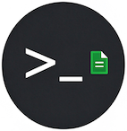

# Visual Paradigm CLI

[中文版](README-zh.md)


Current version: **Sky-First-JiaZi** (1.1.1)

## What
A set of command-line interfaces (CLI) for Visual Paradigm.  Currently, the core feature is to export models to PlantUML.

## Why

- To ask AI help to program, we need to explain business concepts or design logic to AI clearly.
- For complex systems, we need UML models for it.
- Visual Paradigm is one of the good UML modeling tools available for free.
- AI cannot easily read Visual Paradigm model directly.
- AI can easily understand PlantUML.
- PlantUML is essentially a drawing tool, not a modeling tool, and has significant limitations for complex modeling.
- Therefore, we can combine the strengths of both: first model in Visual Paradigm, then use the command line to export to PlantUML as input for AI programming.
- It is easy to teach AI the CLI, and then build a model-based AI development workflow.

## How

### Installation
1. **Download the `.zip` file** from GitHub Releases.
2. **Open Visual Paradigm** and switch to the **Help** tab.
3. Select **Install Plugin**.
4. Select **Install from a zip of plugin** and click **Next**.
5. Browse and select the downloaded `.zip` file.
6. **Restart Visual Paradigm** to complete the installation.
7. After successful installation, a button with icon  will appear before the **About** button in the **Help** tab.

### Configuration

1. Open a terminal.
2. Add executable permissions to the scripts.
    1. Navigate to the script directory under the installed plugin. For example, on Mac, use the following command:
        ```bash
        cd ~/Library/Application\ Support/VisualParadigm/plugins/com.github.zhongjinggz.vpcli/script
        ```
    2. Use the following command to grant permissions to the scripts:
        ```bash
        chmod +x vp-*
        ```
    3. Add the script directory to the environment variable.
        - For example, if using zsh, add the following to `.zshrc`, and then restart the terminal:
            ```
            export PATH="<your-home-dir>/Library/Application Support/VisualParadigm/plugins/com.github.zhongjinggz.vpcli/script:$PATH"
            ```
    4. Set the Visual Paradigm installation directory.
        - Open `vpcli.properties in the `class/` directory under the plugin installation directory:
            ``` 
            ~/Library/Application Support/VisualParadigm/plugins/com.github.zhongjinggz.vpcli/classes/vpcli.properties
            ```
        - Edit the `vp.app` key in the file to the Visual Paradigm installation directory. For example, the following is the default installation directory on Mac:
            ```
            vp.app=/Applications/Visual Paradigm.app/Contents/Resources/app
            ```

### Usage
- **vp-tree** 
  - Purpose: List the packages/diagrams and elements in the model with a tree structure.
  - Usage:
    ```bash
    vp-tree -project <your-visual-paradigm-project>.vpp 
    ```

- **vp-export** 
   - Purpose: Export a Visual Paradigm model to a directory structure and PlantUML.
   - Usage:
     ```bash
     vp-export -project <your-visual-paradigm-project>.vpp -path <output-folder>
     ```

## Roadmap

### Current

- **vp-tree** 
  - Displays all packages, diagrams and elements.
  
- **vp-export** 
  - Only supports package diagrams and class diagrams.
  - Outputs `*.puml` files.

### Goals

- **vp-tree** 
  - Displays only packages by default.
  - Choose whether to display diagrams and elements via arguments.

- **vp-export** 
    - Support the following diagram types:
      - Use Case Diagram
      - Sequence Diagram
      - Component Diagram
      - State Machine Diagram
      - Activity Diagram
      - Deployment Diagram
      
    - Wrap PlantUML in Markdown.
    - Each UML element has its own Markdown file.
    - Establish hyperlinks between the files representing diagrams and elements, and between the files representing elements.

- **vp-mount** 
  - Analogous to the `mount` command, binds a model file to a directory so you don't need to provide the -project argument every time.
   
- **vp-cd** 
    - Analogous to the `cd` command, switches between packages.

- **vp-pwd** 
    - Analogous to the `pwd` command, displays the current package.

- **vp-ls** 
    - Analogous to the `ls` command, displays the packages, diagrams and elements under the current package.

- **vp-cat** 
    - Analogous to the `cat` command, displays the text of a specified diagram or element in the terminal.
    
## Acknowledgments
I didn't know how to write Visual Paradigm plugins at the beginning, especially since the official documentation do not publish how to write command-line plugins. Then, I found this project: https://github.com/nbourdi/PlantUML-VP-Plugin ,which is the starting point of my project. Thanks to the author very much!
