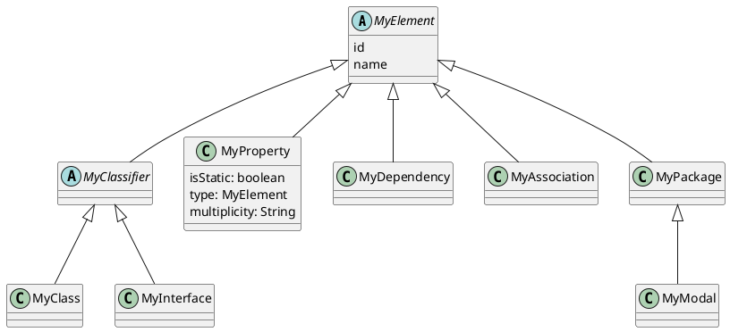
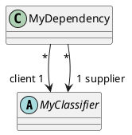
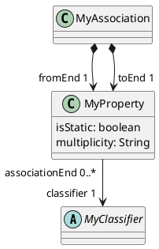
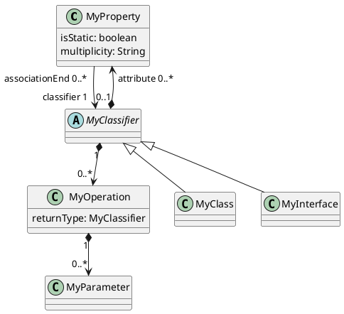

# 架构 Architecture

## 0 Overview

###

#### Element Hierarchy

#### Dependency

#### Association

#### Classifier

## 1 replace 'MyAssociationEnd' with 'MyProperty' 

### 现状：
- Visual Paradigm 模型中的 AssociationEnd 的 ParentId 为空
- Visual Paradigm 模型中 AssociationEnd 和 Attribute 是两个不同的类，与 UML1.4 相符，但 UML2.5中，两者合并为 Property 类。
     
### 需求
- 使 MyAssociationEnd 的父亲是 MyAssociation
- MyAssociationEnd 改名为 MyProperty 
#### Association

### 方案

1. MyAssociationEnd 改名为 MyProperty
2. 在 MyElementFactory 中增加 createRelatedElementWithParent(parent, vpElement), 在本例中代替原来的 createRelatedElement(), 否则会死循环
3. 在 MyAssociationFactory 中调用 createRelatedElementWithParent() 创建 fromEnd 和 toEnd 

## 2 merge 'MyProperty' to "MyAttribute" 

## 用 JSON 打印出内存中的元素树