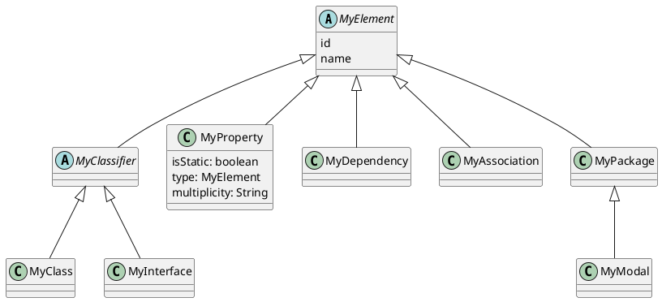
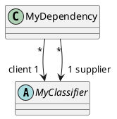
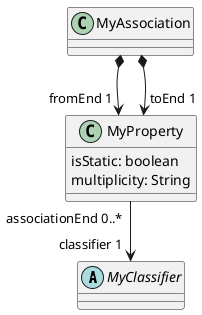
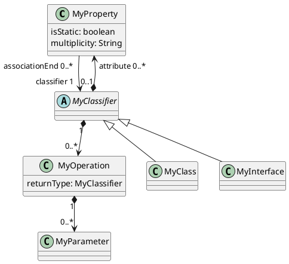
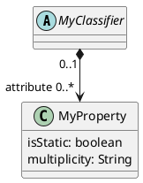

# 架构 Architecture

## 0 Overview

###

#### Element Hierarchy

#### Dependency

#### Association

#### Classifier

## 1 replace 'MyAssociationEnd' with 'MyProperty' 

### 现状：
- Visual Paradigm 模型中的 AssociationEnd 的 ParentId 为空
- Visual Paradigm 模型中 AssociationEnd 和 Attribute 是两个不同的类，与 UML1.4 相符，但 UML2.5中，两者合并为 Property 类。
     
### 需求
- 使 MyAssociationEnd 的父亲是 MyAssociation
- MyAssociationEnd 改名为 MyProperty 

#### Association

### 方案

1. MyAssociationEnd 改名为 MyProperty
2. 在 MyElementFactory 中增加 createRelatedElementWithParent(parent, vpElement), 在本例中代替原来的 createRelatedElement(), 否则会死循环
3. 在 MyAssociationFactory 中调用 createRelatedElementWithParent() 创建 fromEnd 和 toEnd 

## 2 merge "MyAttribute" to 'MyProperty' 

### 背景

- 目前只有一套 MyElementType，暗示着 VP 和本系统的元素分类一致。
- VP 中的分类基本上遵循 UML1, 和 UML2 中不一致，例如：
    - VP 中的 IAttribute 和 IAssociationEnd 在 UML2 中都是 Property
    - UML 中独立的 Interface ，在 VP 中是带 `<<interface>>` 的 IClass (VP 中也有 IInterface 但似乎无用？)
    - VP 中目前的做法其实是 UML1 的做法
- 目前代码中 MyAttribute 不是 MyElement, 虽然目前功能正确，但由于不符合 UML，可能后续带来问题

### 需求

- 为 VP 和 MyElement 建立两套不同的元素类型
- 使用 Property 代替 MyAttribute
- MyProperty 已经是 MyElement，因此 MyAttribute 不是 MyElement的问题自然解决

### 方案

步骤

## 3 在 MyElement 中插入 vpParentId / vpElementType 等信息

### 需求
两个目的
- 调试
- 未来双向修改（从 VP 到处 PlantUML，修改后，再倒回 VP

## 4 用 JSON 打印出内存中的元素树