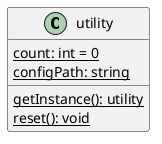
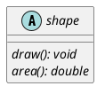
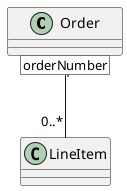
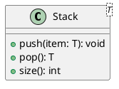
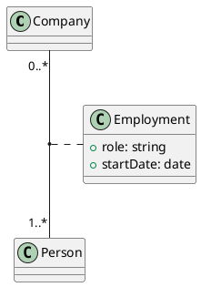
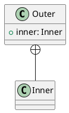
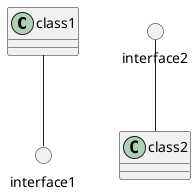
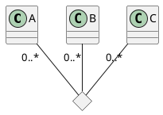

# 类图 Class Diagram - 进阶

## 16 静态操作和静态属性 Static Operation & Static Attribute
- 注意：在 plantuml 文档中操作(operation)称为方法（method），属性(attribute)成为字段（field）

### 需求

`{static}` 用于标记作为类级成员的静态操作与静态属性。

### 方案
TODO

## 17 抽象类 Abstract Class

### 需求

在抽象类中，`{abstract}` 用于声明没有方法体的抽象方法。

### 方案
TODO

## 18 限定关联 Qualified Associations

### 需求

限定关联通过在被关联类一端用方括号 `[..]` 标出限定符（qualifier），表示以某个键来索引关联另一端的实例。

注：该例表示 `Order` 通过 `orderNumber` 限定可定位到多条 `LineItem`。

### 方案
TODO

## 19 泛型类 Generic Class
- 状态：待方案设计
- 注：如 `class Foo<T>`

### 需求

### 方案
TODO

## 20 关联类 Association Class

### 需求

关联类同时作为一条关联和一个类存在，通过 `(被关联类1, 被关联类2) .. 关联类` 语法来表示。

注：`Employment` 为 `Company` 与 `Person` 之间的关联类。

### 方案
TODO

## 21 嵌套类/内部类 Nested Class

### 需求

注：嵌套（内部）类通过 `+--` 组合关系表示隶属关系，或直接在类图中以包含的方式呈现。

### 方案
TODO

## 22 接口实现 Implementation (棒棒糖方式)
- 状态：待编码
### 需求

接口通过“棒棒糖（lollipop）”表示：接口渲染为一个小圆（`circle`），再用**实线**把它接到实现类上。

### 方案

## 多元关联 Multiple Association

### 需求

