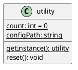
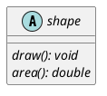
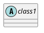
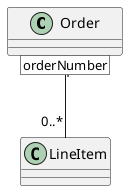
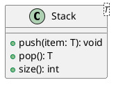
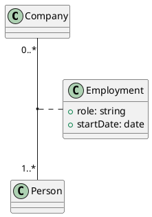
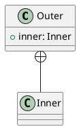
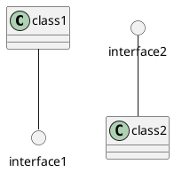
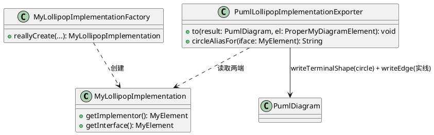

# 类图 Class Diagram - 进阶

## 16 静态操作和静态属性 Static Operation & Static Attribute
- 注意：在 plantuml 文档中操作(operation)称为方法（method），属性(attribute)成为字段（field）

### 需求

`{static}` 用于标记作为类级成员的静态操作与静态属性。

### 方案
TODO

## 17 抽象操作 Abstract Operation
- 注：在 plantuml 文档中称为抽象方法（abstract method）

### 需求

在抽象类中，`{abstract}` 用于声明没有方法体的抽象方法。

### 方案
TODO

## 21 抽象类 Abstract Class
- 状态：待方案设计

### 需求

### 方案
TODO

## 22 限定关联 Qualified Associations

### 需求

限定关联通过在被关联类一端用方括号 `[..]` 标出限定符（qualifier），表示以某个键来索引关联另一端的实例。

注：该例表示 `Order` 通过 `orderNumber` 限定可定位到多条 `LineItem`。

### 方案
TODO

## 25 泛型类 Generic Class
- 状态：待方案设计
- 注：如 `class Foo<T>`

### 需求

### 方案
TODO

## 26 关联类 Association Class

### 需求

关联类同时作为一条关联和一个类存在，通过 `(被关联类1, 被关联类2) .. 关联类` 语法来表示。

注：`Employment` 为 `Company` 与 `Person` 之间的关联类。

### 方案
TODO

## 27 嵌套类/内部类 Nested Class

### 需求

注：嵌套（内部）类通过 `+--` 组合关系表示隶属关系，或直接在类图中以包含的方式呈现。

### 方案
TODO

## 12 接口实现 Implementation (棒棒糖方式)
- 状态：待编码
### 需求

接口通过“棒棒糖（lollipop）”表示：接口渲染为一个小圆（`circle`），再用**实线**把它接到实现类上。

### 方案

**目标：** 仅“导出/渲染”路径——读取 VP 中“类实现接口”的关系，将接口渲染为 `circle`，并用实线连接到实现类。**不涉及导入。**

**现状分析（已核对源码）：**
- 输出模型层已有渲染“终端形状”的能力：`PumlDiagram.writeTerminalShape(String)`（src/.../outputmodel/PumlDiagram.java:51）可输出任意一段图元文本（如 `circle interface1`）。
- `PumlDiagram.writeEdge(PumlEdgeEnd, PumlEdgeEnd, LineStyle, String name, NameDirection direction)` 的 `LineStyle.SOLID("--")` 已具备实线能力（#9 已完成）。
- 新输出模型中没有任何“实现/接口关系”的模型类与导出器注册（见 #11 现状分析第 2 点）。

**设计图（棒棒糖导出相关模块）：**

**实施步骤（每步可独立验证）：**

1. **建模（领域模型层）。**
    - 方案：新建 `MyLollipopImplementation extends MyElement`，持有 implementor / interfaceElement（各为一个 `MyElement`）。在 `MyElementType` 新增 `IMPLEMENTATION`（或复用已计划的关系容器类型）枚举项。
    - 理由：棒棒糖实现与常规实现（#20 `..|>`）在渲染上是两种不同形态，需能区分；但其底层关系又同为“实现”，建模时视 VP 关系类型决定是否与 #20 共用一个模型类（研究项）。
    - 验证：为模型及工厂写基础单元测试。

2. **读取（工厂/访问器）。**
    - 方案：新建 `MyLollipopImplementationFactory`（参考 `MyAssociationFactory`），从 VP 读取实现类与接口元素。
    - 验证：用桩数据断言 implementor / interface 正确提取。

3. **渲染（输出模型层）。**
    - 方案：新建 `PumlLollipopImplementationExporter`，`to(...)`：
        - 用 `writeTerminalShape("circle \"<接口名>\" as <别名>")` 输出棒棒糖小圆；
        - 用 `writeEdge(<实现类别名>, <接口圆别名>)` 以实线连接实现类与小圆。
    - 理由：`circle` 独立为一个形状，之后用实线把它挂到实现类上，正好还原 VP 的棒棒糖语义；复用 `writeTerminalShape` 不必为 circle 单独建导出器。
    - 验证：为导出器写单元测试，断言输出包含 `circle ...` 行与 `实现类 -- 接口圆` 实线行；`interface2 -- class2` 形式通过交换 from/to 得到。

4. **接线与去重（渲染编排）。**
    - 方案：多个类实现同一接口时，只为该接口输出**一个** `circle`，被多个实现类实线共用；需在渲染编排层保证 circle 声明不重复（可在导出器/容器中做去重，参考现有 package/class 渲染的去重策略）。
    - 理由：PlantUML 中以别名复用圆即可实现一对一棒棒糖语义；重复声明会导致歧义。
    - 验证：构造“两个类实现同一接口”的桩数据，断言只输出一行 `circle` 且两条实线分别指向同一别名。

5. **注册、回归与集成验证。**
    - 方案：在 `PumlElementExporterFactory` 注册 `IMPLEMENTATION` 导出器。
    - 验证：工厂单测验证 `of(IMPLEMENTATION)`；整体 `mvn test` 无回归；手动在 VP 中导出棒棒糖实现，确认 `.puml` 可被 PlantUML 正确渲染。

**说明/边界：** 本条目仅处理“棒棒糖”呈现形态；常规的 `..|>` 实现（如 Java `implements` 拉出来一条虚线三角）属 #20，两者在 VP 中可能表现同一种“实现”关系，最终统一成一个建模并向不同导出器分发（研究项）。本条目不涉及导入。
