# 类图 Class Diagram - 进阶

## 01 限定关联 Qualified Associations

### 需求

限定关联通过在被关联类一端用方括号 `[..]` 标出限定符（qualifier），表示以某个键来索引关联另一端的实例。

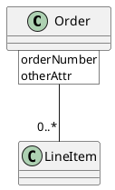

注：该例表示 `Order` 通过 `orderNumber` 限定可定位到多条 `LineItem`。

### 方案

**目标：** 仅“导出”路径——把关联某一端的 qualifier 投影为端点前的 `[限定符]`，其余多重性/角色仍按 #4/#5/#7 语义渲染。不涉及导入。

**现状分析（已核对源码 + javap openapi.jar）：**
- `IAssociationEnd`（com.vp.plugin.model.IAssociationEnd）提供 `getQualifier()` 返回 `IQualifier`；`IQualifier`（extends IHasChildrenBaseModelElement）携带多个 `IAttribute`，经 `toAttributeArray()` 读取。每个限定符属性的 `getName()` 即方括号内应展示的标识（如 `orderNumber`）。
- 限定的语义归属：VP 中 qualifier 挂在某个关联端（`IAssociationEnd.getQualifier()`），需在该端渲染 `[qualifier]`。
- 当前 `PumlAssociationExporter`（src/.../pumlclass/PumlAssociationExporter.java）的 `getMultiplicityAndRole`（:61）只渲染 role 与 multiplicity，未读取 qualifier——需扩展。

**设计图（`PumlAssociationExporter` 的端点渲染扩展）：**

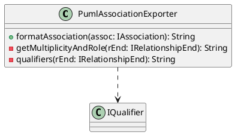

**实施步骤（每步可独立验证）：**

1. **读取 qualifier 列表（`PumlAssociationExporter` 新增 `qualifiers` 帮助方法）。** 对给定 `IRelationshipEnd`，cast 为 `IAssociationEnd`，`getQualifier()` 非空时取其 `IQualifier.toAttributeArray()`，过滤出 `getName()` 非空元素，得非空名列表。无 qualifier 或全空时返回空串。
   - 验证：单测桩 `IAssociationEnd.getQualifier()` 返回含一个 `IAttribute("orderNumber")` 的 `IQualifier`，断言列表为 `["orderNumber"]`；返回 null 或空 attribute 时列表为空。

2. **端点文本拼接 qualifier（`getMultiplicityAndRole`）。** 在现有 buildMultipRole 的形式之外，将限定符以前缀 `[<name>]` 拼接到该端文本最前面（限定符属于被关联类端，紧贴该端 alias 前的端点标签）。最终端点形如 `"[orderNumber] \"1\""`。
   - 验证：单测桩关联——from 端 `Order`（无 qualifier、multiplicity "1"）、to 端 `LineItem`（qualifier `orderNumber`、multiplicity "0..*"），断言导出 `Order "[1]... ` 形式与需求 `order [orderNumber] "1" -- "0..*" lineItem` 对齐（方向/角色按端归属渲染）。

3. **回归。** `mvn test` 无回归（原测试保持通过）；未改 `PumlDiagram`/`writeEdge`/分发机制。

4. **集成验证。** 在 VP 中为关联端添加 qualifier 后导出，检查 `.puml` 端点出现 `[orderNumber]`；PlantUML 预览在关联端显示方形限定符。

**说明/边界：** 本条目仅处理导出侧 qualifier 的读取与投影；限定符属性若带类型（`IAttribute.getTypeAsString()`）当前仅展示名称，不展示类型括号内内容（与需求示例一致）。多重性/角色/聚合渲染逻辑保持 #4–#8 不动。

## 02 泛型类 Generic Class
- 状态：待方案设计
- 注：如 `class Foo<T>`

### 需求

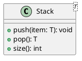

### 方案

**目标：** 仅“导出”路径——把类的模板参数（泛型）追加为类名后的 `<T, U>` 后缀（紧跟类名、在 `as alias` 之后、块体 `{` 之前按 PlantUML 语法置于块声明尾）。不涉及导入。

**现状分析（已核对源码 + javap openapi.jar）：**
- `IClass` 的模板参数接口：SDK 属 `IModelElement`，模板/泛型参数通常经 `ITemplateParameter` 或 tagged value 表达。需确认 VP 具体读取 API（见研究 1）。
- `PumlBlockExporter.buildBlockSuffix`（:43）已支持在块声明尾追加“关键字 + 原型”后缀——泛型 `<T>` 是类名内嵌项，PlantUML 中 `class Stack<T>` 需把 `<T>` 放在块类型关键字与原型的组合处。当前 `beginBlock`（PumlDiagram:26）用 `blockType "name" as alias suffix {`，泛型应进入 name 之后或作为 suffix 的一部分。

**设计图（`PumlClassExporter` 覆写 `buildBlockSuffix`）：**

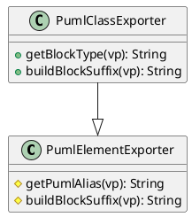

**实施步骤（每步可独立验证）：**

1. **研究：确认模板参数读取 API。** 用 javap 检查 `com.vp.plugin.model.IClass` 与其父接口（`IModelElement`/`ITemplateParameter` 相关），确认读取泛型参数名的接口（如 `toTemplateParameterArray()`/`getName()`）。
   - 验证：`javap -classpath openapi.jar com.vp.plugin.model.IClass ...` 输出含模板参数方法；据此编写读取代码。

2. **读取泛型参数（`PumlClassExporter` 新增帮助方法 `templateParams(vp)`）。** 依研究结果从 `IClass` 读非空模板参数名列表，形如 `T`、`U`。
   - 验证：单测桩 `IClass` 返回模板参数 `["T"]`，断言列表正确；空类返回空串。

3. **拼接泛型后缀（覆写 `buildBlockSuffix`）。** 在 `PumlClassExporter` 中覆写 `buildBlockSuffix`：把模板参数渲染为 `<T, U>` 并置于原型/关键字之后（PlantUML `class Stack<T>` 语法，`<T>` 紧跟类名、在 `as alias` 前）。若实现上 `beginBlock` 的顺序不允许在 name 后插入，则改为把 `<T>` 拼进 suffix 首部。
   - 验证：单测桩 `IClass("Stack", [T])`，断言块头端到端为 `class "Stack" as Stack <T> ...`（依最终确定语法）。

4. **端到端集成验证。** 在 VP 中创建带模板参数的类后导出，检查 `.puml` 类声明显式含 `<T>`；PlantUML 预览在类名后显示泛型参数。

**说明/边界：** 本条目为待方案设计，需先以 javap 确认模板参数读取 API 再落码。仅处理类的泛型声明（类级模板参数），不处理属性/参数中引用的泛型类型（如 `push(item: T)` 中 `T` 直接按类型名原样输出，无需处理）。

## 03 关联类 Association Class

### 需求

关联类同时作为一条关联和一个类存在，通过 `(被关联类1, 被关联类2) .. 关联类` 语法来表示。

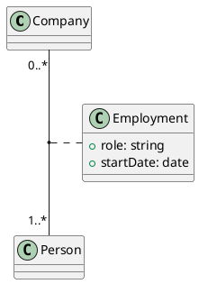

注：`Employment` 为 `Company` 与 `Person` 之间的关联类。

### 方案

**目标：** 仅“导出”路径——①关联类本身照常以类块（`class`）导出其成员；②把“关联类 ↔ 关联线”专属的连接符（VP 中关联类与关联的虚连线）渲染为 `(alias1, alias2) .. associationClassAlias` 形式。不涉及导入。

**现状分析（已核对源码 + javap openapi.jar）：**
- 关联类在 VP 中作为一个类元素建模，同时有一条从它连到关联线的“类关联连接”关系线。需识别该连线对应的 shape type 与模型接口。
- 当前`PumlDiagramFactory`（:27）已把连接线统一按 `getShapeType()` 分发；关联线本身由 `PumlAssociationExporter`（SHAPE_TYPE_ASSOCIATION）渲染。故只需新增“关联类连接”导出器，命中后输出 `(from, to) .. class`。
- 需 javap 确认该连线类型常量（候选 `IAssociationClassDiagramElement`/`IShapeTypeConstants` 之 `SHAPE_TYPE_ASSOCIATION_CLASS`，若有）。

**设计图（新增导出器与注册）：**

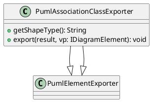

**实施步骤（每步可独立验证）：**

1. **研究：确认连线类型与模型接口。** javap 检查 `IShapeTypeConstants` 是否含 `SHAPE_TYPE_ASSOCIATION_CLASS`；确认连线的模型接口（from=两个被关联类所在关联、to=关联类自身）。
   - 验证：javap 输出确认常量存在及 getFrom()/getTo() 可用的模型接口。

2. **实现连线渲染（新增 `PumlAssociationClassExporter`）。** `getShapeType()` 返回对应常量；`export` 取连线模型，`from`=被关联类 A/别名、`to`=关联类别名，输出 `result.writeTerminalShape("(" + fromAlias + ", " + toAlias + ") .. " + classAlias)`。需依真实模型读取 from/to 两个元素与关联类。
   - 验证：单测桩连线模型（from/to 别名可读），断言输出 `(company, person) .. employment`。

3. **接线与回归。** 在 `PumlElementExporterRepository` 构造器注入并 `register(...)` 新导出器；`mvn test` 无回归。

4. **集成验证。** 在 VP 中建立 Company–Person 关联类后导出，检查 `.puml` 出现 `(company, person) .. employment`；PlantUML 预览显示关联类菱形虚线接入关联线。

**说明/边界：** 本条目为待编码/研究，需先确认连线类型常量与模型接口。仅处理导出侧关联类连线；关联类的成员仍由 `PumlClassExporter` 正常导出，两者各自独立。

## 04 嵌套类/内部类 Nested Class

- 状态：已完成

### 需求

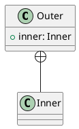

注：嵌套（内部）类通过 `+--` 组合关系表示隶属关系，或直接在类图中以包含的方式呈现。

### 方案

**目标：** 仅“导出”路径——把嵌套的“内部类↔外部类”包含关系（PlantUML `+--` 组合）渲染出来。不涉及导入。

**现状分析（已核对源码 + javap openapi.jar）：**
- VP 中嵌套类通常建模为内部类元素（`IModelElement` 类型为 `NestedClassifier`/`IClass` 子元素）或一条包含关系线。需 javap 确认内部类/包含关系对应的 shape type 与模型接口。
- 若嵌套类以 `toChildArray()` 的父子形状表达（`PumlBlockExporter.exportBlockBody` 已递归 child），且 `allowmixing` 下 PlantUML 用 `+--` 表达组合，则可按“类组合线”导出器处理。
- `PumlDiagram.toString`（PumlDiagram:26）已含 `allowmixing` 指令，支持混合图元素。

**设计图（新增导出器与注册）：**

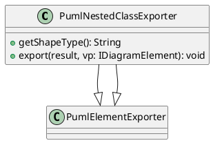

**实施步骤（每步可独立验证）：**

1. **研究：确认内部类/包含关系类型。** javap 检查 `IShapeTypeConstants` 与模型常量，确认嵌套类导出应走的 shape type（可能复用 `SHAPE_TYPE_ASSOCIATION` + composite 聚合→`*--`，或专门的 nested 线）。
   - 验证：javap 输出确认常量；据此决定渲染 `outer *-- inner`（组合）还是专门线。

2. **实现嵌套类渲染。** 依研究结果：若复用关联组合语义，则由现有 `PumlAssociationExporter` 的 composite 聚合分支（`ShapeKind.SOLID_DIAMOND`→`*--`）自然覆盖，仅需确认内外类正确建模为关联；若为专门类型则新增 `PumlNestedClassExporter` 输出 `outer +-- inner`。
   - 验证：单测桩对应模型，断言输出 `outer +-- inner`（或 `outer *-- inner`，依确定语义）。

3. **接线与回归。** 若新增导出器，在 `PumlElementExporterRepository` 注入并注册；`mvn test` 无回归。

4. **集成验证。** 在 VP 中创建嵌套类后导出，检查 `.puml` 出现 `outer +-- inner` 或组合线；PlantUML 预览显示 Out 包含 Inner 的组合/包含结构。

**说明/边界：** 本条目为待编码/研究，需先确认 VP 对嵌套类的建模形态（父子形状 vs 关联线）。最终输出形式（`+--` 或 `*--`）随研究结论确定，与需求示例尽量对齐。

## 05 接口实现 Implementation (棒棒糖方式)
- 状态：待编码
### 需求

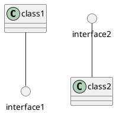

接口通过“棒棒糖（lollipop）”表示：接口渲染为一个小圆（`circle`），再用**实线**把它接到实现类上。

### 方案

**目标：** 仅“导出”路径——①把接口元素渲染为小圆 `circle <接口名> as <别名>`；②把实现类与圆之间用实线 `--` 连接。不涉及导入。

**现状分析（已核对源码 + javap openapi.jar）：**
- 需求中 `circle` 为 PlantUML 的接口棒棒糖形状。VP 侧接口若以 `<<interface>>` 原型类建模，则常规方式下用 `PumlRealizationExporter` 虚线 `..` 连接已覆盖（见 basic #18）。本“棒棒糖方式”需把实现线渲染为实线 `--` 并把接口侧端点画成小圆。
- 需识别 VP 中等价模型：实现仍为 `IRealization`（`SHAPE_TYPE_REALIZATION`），区别仅渲染样式（circle + 实线）。因此方案是对现有 Realization 导出增加样式分支：当接口以棒棒糖呈现时输出 `class1 -- interface1` 并声明 `circle interface1`。
- 是否区分两种方式需由 VP 图模型提供（如 shape 的样式/接口形状类型），需 javap 调研。

**设计图（`PumlRealizationExporter` 扩展 + 可选 `PumlCircleExporter`）：**

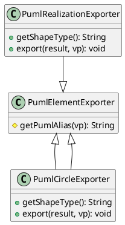

**实施步骤（每步可独立验证）：**

1. **研究：确认棒棒糖在 VP 中的建模。** javap `IShapeTypeConstants` 与接口形状模型，确认是否存在独立的接口棒棒糖形状类型（如 `SHAPE_TYPE_CIRCLE`/`SHAPE_TYPE_INTERFACE_LOLIPOP`），或仅靠 line 样式区分。
   - 验证：javap 输出确认；据此设计导出分支。

2. **渲染 circle（若为独立形状：新增 `PumlCircleExporter`）。** `getShapeType()` 返回对应常量；`export` 输出 `circle "接口名" as 别名`。若 VP 以 `<<interface>>` 类 + 实线区分，则改用单导出器分支判断。
   - 验证：单测桩，断言输出 `circle interface1`。

3. **实现线渲染为实线（`PumlRealizationExporter` 扩展）。** 当棒棒糖方式时输出 `class1 -- interface1`（实线、无三角），替代默认 `class1 <|.. interface1`；否则保持 basic #18 的虚线空心三角。
   - 验证：单测桩带/不带棒棒糖标记，分别断言 `class1 -- interface1` 与 `class1 <|.. interface1`。

4. **接线与回归。** 依研究结果在 `PumlElementExporterRepository` 注入/注册相关导出器或复用现有 Realization；`mvn test` 无回归。

5. **集成验证。** 在 VP 中以棒棒糖方式实现接口后导出，检查 `.puml` 出现 `circle interface1` 与 `class1 -- interface1`；PlantUML 预览显示小圆接口 + 实线。

**说明/边界：** 本条目为待编码，需先确认 VP 对棒棒糖接口的建模形态（独立 circle 形状 vs `<<interface>>` 类+实线）。输出朝向往 PlantUML 棒棒糖标准语法靠拢，与需求示例对齐。

## 06 多元关联 Multiple Association

### 需求

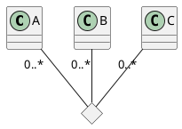

### 方案

**目标：** 仅“导出”路径——①把 n-ary 关联的枢纽元素（PlantUML `diamond`）渲染为菱形 `diamond <别名>`；②把每个参与类用带多重性的实线 `--` 连到菱形。不涉及导入。

**现状分析（已核对源码 + javap openapi.jar）：**
- VP 中多元（n-ary）关联以 `INaryAssociation`/`IAssociation` + 关联端建模，中心是一个 n-ary 关联形状（`IAssociationDiagramElement`/`IShapeTypeConstants` 的 `SHAPE_TYPE_NARY_ASSOCIATION` 或类似）。需 javap 确认常量。
- PlantUML 用 `diamond nary1` 声明 n-ary 关联节点，类与菱形间以实线 `--` 连接并带多重性端点标签。

**设计图（新增导出器与注册）：**

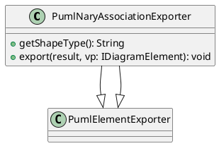

**实施步骤（每步可独立验证）：**

1. **研究：确认 n-ary 关联形状类型与接口。** javap 检查 `IShapeTypeConstants` 是否有 `SHAPE_TYPE_NARY_ASSOCIATION`（或等价）；确认模型接口（`INaryAssociation`）的 from/to 读取方式（中心与各端）。
   - 验证：javap 输出确认常量与方法签名。

2. **渲染菱形（新增 `PumlNaryAssociationExporter`）。** `getShapeType()` 返回对应常量；`export` 输出 `diamond <别名>`。
   - 验证：单测桩，断言输出 `diamond nary1`。

3. **渲染连线（关联端到菱形）。** 复用/扩展 `PumlAssociationExporter` 使每个参与类 `A "0..*" -- nary1`。需把 n-ary 关联的各参与端渲染为带多重性的实线连到菱形别名。
   - 验证：单测桩 n-ary 关联含 A/B/C 三端，断言输出 `A "0..*" -- nary1`、`B "0..*" -- nary1`、`C "0..*" -- nary1`。

4. **接线与回归。** 在 `PumlElementExporterRepository` 注入并注册新导出器（或复用 association 分支）；`mvn test` 无回归。

5. **集成验证。** 在 VP 中创建三元关联后导出，检查 `.puml` 出现 `diamond nary1` 与各 `X "0..*" -- nary1`；PlantUML 预览显示菱形 n-ary 关联三条实线。

**说明/边界：** 本条目现无“### 方案”编号（需求紧接 #22 后），方案以“多元关联”主题编写。需先确认 VP 对 n-ary 关联的形状类型与模型接口；仅处理导出侧，导入不在本条目范围。
