# 类图 Class Diagram

## 1 包 package

- 状态：已完成

### 需求

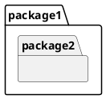
- 注意： PlantUML 中的 "namespace" 才对应 UML package

### 方案
略

## 2 模型 Model

- 状态：已完成

### 需求

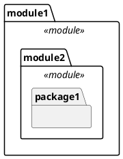

### 方案

略

## 3 类 Class

- 状态：已完成

### 需求

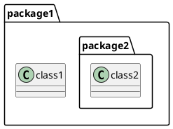

### 方案

略

## 4 关联 Association

- 状态：已完成

### 需求

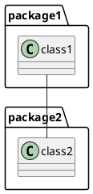

### 方案

略

## 5 多重性 Multiplicity

- 状态：已完成

### 需求

```plantuml
@startuml

namespace "package1" as package1{
class "class1" as package1__class1 {
}
}

namespace "package2" as package2 {
class "class2" as package2__class2 {
}
}

package1__class1 "1"--"0..1" package2__class2
package1__class1 "1"--"0..*" package2__class2
package1__class1 "*"--"1..*" package2__class2

@enduml
```

### 方案

略

## 6 导航 Navigation

- 状态：已完成

### 需求

```plantuml
@startuml
class1 "1"-->"0..1" class2
class3 "1"<--"0..*" class4
class5 "*"<-->"1..*" class6
class7 "*"x-->"1..*" class8
class9 "*"x--x"1..*" class10
class11 "*"--"1..*" class12
@enduml
```

### 方案

略

## 7 角色 Role

- 状态：已完成

### 需求

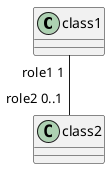

### 方案

略

## 8 聚合与组合 Aggregation & Composition

- 状态：已完成

### 需求

```plantuml
@startuml
class1 "1"*--"0..*" class2
class3 "1"o--"0..*" class4
@enduml
```
-注意： `*--` 表示组合（Composition），`o--` 表示聚合（Aggregation）

### 方案
略

## 9 关联名称 Association Name
- 状态：已完成

### 需求

```plantuml
@startuml
class1 "1"*--"0..*" class2: doSomething >
class3 "1"o--"0..*" class4: < doSomething
@enduml
```

关联名称（名称标签，如 `doSomething`）贴在关联线上，名称旁可带一个实心小三角（`>` 或 `<`），指示名称的**阅读方向**（对应 UML 中关联名称旁的小实心三角），而非位置记号。

### 方案

**目标：** 扩展导出渲染，使关联线可输出名称及阅读方向三角；不改动导入，仅触及输出模型层（`PumlDiagram`）与关联导出器（`PumlAssociationExporter`）、关联模型（`MyAssociation`）。

**现状分析（已核对源码）：**

- 关联线渲染集中在 `PumlDiagram.writeEdge(PumlEdgeEnd, PumlEdgeEnd, LineStyle)`（src/.../outputmodel/PumlDiagram.java:82）：目前把 role 与 multiplicity 合并成**每一端一个**引号标签，不输出关联名称，也不带方向三角。
- `PumlEdgeEnd.ShapeKind`（.../PumlEdgeEnd.java）表达的是**端点的导航符号**，与名称阅读方向三角是两个概念，不可混用。
- 阅读方向的真实数据来源是 VP 的 `IAssociation.getDirection()`，返回 `IAssociation.DIRECTION_FROM_TO` 或 `IAssociation.DIRECTION_TO_FROM`。
- `MyAssociation.getName()`（.../myassociation/MyAssociation.java:18 经 `MyElement_old2`）已持有 VP 的关联名称；从 VP 获取关联名称时若返回 `null`，在读数层归一化为空串 `""`。


**设计图（导出器内部协作）：**

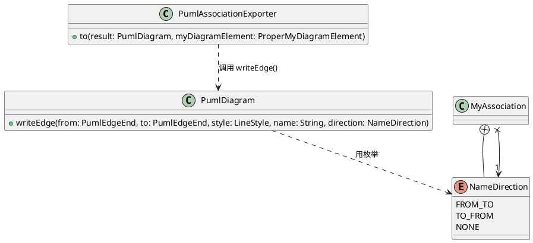

**实施步骤（每步可独立验证）：**

1. **定义阅读方向枚举（`MyAssociation` 内部类）。**
   - 方案：在 `MyAssociation` 中新增内部枚举 `NameDirection`，取值 `FROM_TO`、`TO_FROM`、`NONE`；其中 `NONE` 仅用作“无名称”时的占位符。
   - 理由：方向的语义（DIRECTION_FROM_TO / DIRECTION_TO_FROM）属于关联本身，作为 `MyAssociation` 的内部类最贴合领域模型，不放在 `PumlEdgeEnd` 上。
   - 验证：为 `MyAssociation` 写单元测试，断言该枚举的三个取值存在。

2. **读取层捕获方向并归一化（`MyAssociationFactory`）。**
   - 方案：在 `MyAssociationFactory`（src/.../myassociation/）读取 VP 关联时，取 `IAssociation.getDirection()`，映射为 `NameDirection.FROM_TO`/`TO_FROM`，两者之外归为 `NONE`；关联名称若返回 `null` 归一化为 `""`。
   - 验证：为工厂写单元测试，分别用 `DIRECTION_FROM_TO`、`DIRECTION_TO_FROM`、`null` 的桩断言方向与名称正确落值。

3. **渲染层签名改为 5 参数（`PumlDiagram`）。**
   - 方案：直接将 `writeEdge(PumlEdgeEnd, PumlEdgeEnd, LineStyle)` 扩展为 `writeEdge(PumlEdgeEnd, PumlEdgeEnd, LineStyle, String name, NameDirection direction)`，**不再保留 3 参数 API**（同一处调用点同步更新）。
   - 方法内部：判断 `name` 是否为空或空白（`null`/空串/纯空白）——
     - 为空或空白：按原有逻辑输出，不追加 `: `，也不输出方向三角；
     - 非空：追加 `: <name>`，并结合 `direction` 决定三角符号（详见步骤 4 的“`>` / `<` 选择规则”）。
   - 理由：名称是关联线的必备能力且只此一种通过途径，直接改签名避免维护两套 API。
   - 验证：对 `PumlDiagram` 写单元测试，覆盖“名称非空 + 方向 FROM_TO/TO_FROM”“名称为空串”“名称为纯空白”等分支。

4. **“`>` / `<`”选择算法。**
   - 说明：需求中方向箭头位于关联名称旁（`doSomething >` 或 `< doSomething`），表示名称的阅读方向；其数据来自 `IAssociation.getDirection()`。约定 `writeEdge(from, to)` 的 **from 恒在左、to 恒在右**，且 VP 的 `DIRECTION_FROM_TO`/`DIRECTION_TO_FROM` 的 from/to 与 `writeEdge` 传入的两端一致。
   - 规则（纯方向判断，不依赖端序）：
     - `FROM_TO`：阅读从左到右 → 输出 `name  >`（三角在名称右侧）；
     - `TO_FROM`：阅读从右到左 → 输出 `<  name`（三角在名称左侧）；
     - `NONE`：不输出三角。
   - 理由：因 from 恒在左且 VP 方向与端序一致，无需再判断端序，直接按方向选用符号即可；三角由“阅读方向”派生而非端点导航符号，故不复用 `PumlEdgeEnd.ShapeKind` 的 `ARROW/REVERSE_ARROW`。
   - 验证：用方向不同组合的桩数据断言输出三角朝向正确，并对照需求图（`doSomething >` 与 `< doSomething`）。

5. **导出器接线（`PumlAssociationExporter`）。**
   - 方案：`to(...)` 中调用 5 参数 `writeEdge`，传入 `association.getName()`（已归一化为 `""`）与 `association` 持有的 `NameDirection`；无名称时由第 3 步内部逻辑回退，保证旧用例（无名称）输出不变（如 `A -- B`）。
   - 理由：保持现有无名称关联输出兼容，避免破坏既有测试 `shouldOmitMultiplicityWhenEmpty` 等。
   - 验证：扩展 `PumlAssociationExporterTest`，新增“带名称→输出 `: name`”“带方向→输出对应三角”“名称空→无 `:`”等断言；跑该测试类。

6. **回归与集成验证。**
   - 验证：整体 `mvn test`（仓库内现有测试）确认无回归（注意同步更新调用 3 参数 `writeEdge` 的既有测试/调用点）；手动在 VP 中导出带名称/带方向、以及无数值关联，检查 `.puml` 可被 PlantUML 正确解析渲染。

**说明/边界：** 名称与多重性、角色分属不同标签位（名称在连线中央、role+multiplicity 在端），二者不冲突；名称为空/空白时不输出方向三角；`NONE` 仅作无名称时的占位。

## 10 依赖 Dependency
- 状态：已完成

### 需求
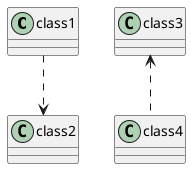

### 方案

**目标：** 仅“导出/渲染”路径——读取 VP 中的依赖关系，在类图中渲染为带方向的虚线箭头 `..>`。**不涉及导入。**

**现状分析（已核对源码）：**
- 新输出模型（`domain/outputmodel`）目前没有“依赖”对应的模型类、`MyElementType` 或导出器；`PumlElementExporterFactory`（src/.../outputmodel/pumelementexporter/PumlElementExporterFactory.java）目前注册了 ASSOCIATION / CLASS / PACKAGE / MODEL / RELATIONSHIPS / USE_CASE / UNIMPLEMENTED_ELEMENT，未含依赖。
- 旧 `MyRelationship_old.toExportFormat()`（src/.../myuml_old/mycommon_old/MyRelationship_old.java）里有 `case "Dependency": symbol = "..>"` 分支，但它属于旧导出路径，不被新流水线消费，因此需在新架构补齐。
- 渲染基础已具备：`PumlDiagram.writeEdge(PumlEdgeEnd, PumlEdgeEnd, LineStyle, String name, NameDirection direction)` 支持 `LineStyle.DASHED("..")` 与 `PumlEdgeEnd.ShapeKind.ARROW(">")`，组合即可生成“虚线 + 目标端箭头”的 `..>`（from 在左、to 在右，箭头贴合 to 端）。

**研究结论（已用 `javap` 反编译 VP SDK `openapi.jar` 核对）：**
- **接口**：VP 有独立依赖接口 `com.vp.plugin.model.IDependency`（继承 `IHasRelationshipBaseSimpleRelationship` → `ISimpleRelationship` → `IRelationship` → `IModelElement`）。
- **模型类型常量**：`IModelElementFactory.MODEL_TYPE_DEPENDENCY = "Dependency"`。
- **端点读取**：`IDependency.toFromRelationshipEndArray()` → `IRelationshipEnd[]`（源端）、`toToRelationshipEndArray()` → `IRelationshipEnd[]`（目标端）；每端 `IRelationshipEnd.getModelElement()` 返回该端绑定的分类器 `IModelElement`。因此 from = `toFromRelationshipEndArray()[0].getModelElement()`，to = `toToRelationshipEndArray()[0].getModelElement()`。
- **工厂注册**: `buildRoot` 须能用 modelType=`"Dependency"` 查得依赖工厂（见步骤 3）

**设计图（依赖导出相关模块）：**

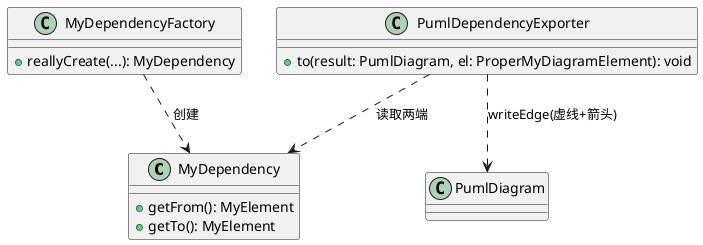

**实施步骤（每步可独立验证）：**

1. **建模（领域模型层）。**
   - 方案：新建 `MyDependency extends MyElement`，持有 from / to（各为一个 `MyElement_old2`）。在 `MyElementType`（.../myuml/myelement/MyElementType.java）增加 `DEPENDENCY` 枚举项，绑定 VP 类型 `MODEL_TYPE_DEPENDENCY`。
   - 理由：依赖与关联在 UML 上是不同关系类型，独立建模便于后续导入与发展。
   - 验证：为 `MyDependency` 及工厂写基础单元测试（构造、getter、类型后缀、`vpModelTypeIs("Dependency")`）。

2. **读取（工厂/访问器）。**
   - 方案：新建 `MyDependencyFactory`（参考 `MyAssociationFactory`，src/.../myassociation/），`reallyCreate()` 中把 `IModelElement` 强转 `IDependency`：
     - `from = ((IDependency) vpElement).toFromRelationshipEndArray()[0].getModelElement()`
     - `to = ((IDependency) vpElement).toToRelationshipEndArray()[0].getModelElement()`
   - 验证：用桩 `IDependency` 断言 from/to 正确提取。

3. **注册依赖工厂（`MyElementFactoryFactory`）**
     - 方案：在 `MyElementFactoryFactory`（.../myuml/myelement/MyElementFactoryFactory.java）构造器注入 `MyDependencyFactory` 并 `register(MODEL_TYPE_DEPENDENCY, myDependencyFactory)`。
     - 理由：`buildRoot` 用 `getModelType()` 查工厂；当前 `MyElementFactoryFactory.of()` 对未注册类型会回退到 `UNIMPLEMENTED_ELEMENT` 工厂并 `log.warn`（不抛异常），注册后才不会把“依赖”误建成 UnimplementedElement。
     - 验证：单测验证 `of("Dependency")` 能取到 `MyDependencyFactory` 并创建元素。

4. **图元类型注册（`DiagramElementType`）。**
   - 方案：`MyDiagramElementFactory.createMyDiagramElement` 会用 `DiagramElementType.of(vpElement.getShapeType())` 记录图元类型（.../mydiagram/mydiagramelement/DiagramElementType.java），其 `Kind` 决定图元被 `MyDiagram.addSubDiagramElement` 归入 `subShapes` 还是 `subEdges`。依赖连接线是“边”，因此需在枚举中新增 `DEPENDENCY(SHAPE_TYPE_DEPENDENCY, Kind.EDGE)`（与既有 `ASSOCIATION(SHAPE_TYPE_ASSOCIATION, Kind.EDGE)` 一致）；否则 `DiagramElementType.of("Dependency")` 会回退到 `UNIMPLEMENTED_DIAGRAM_ELEMENT`（`Kind.SHAPE`），把依赖连接线误归入 `subShapes`。
   - 理由：`PumlDiagramFactory.of()` 按 `subShapes`→`subEdges` 两组遍历并按 `MyElementType` 分派导出器；虽然未注册时依赖可能仍在 `subShapes` 里被导出，但语义上依赖是 EDGE，归入 `subEdges` 才能保证输出顺序与后续 subEdges 专用处理一致。
   - 验证：单测验证 `DiagramElementType.of(SHAPE_TYPE_DEPENDENCY)` 返回 `DEPENDENCY` 且 `isEdge()` 为真（参考 `MyDiagramFactoryTest` 对 ASSOCIATION 的断言方式）。

5. **导出渲染（输出模型层）。**
   - 方案：新建 `PumlDependencyExporter`，`to(...)` 中把 from 放左、to 放右，调用 5 参数 `PumlDiagram.writeEdge(from, to, LineStyle.DASHED, name, NameDirection)`（签名同 #9 方案步骤 3，见 spec 条目 #9）：
     - `name`：传依赖名称，其空/空白归一化逻辑与关联一致（`association.getName()` 归一化为 `""`，空则不输出 `: name`）；
     - `DIRECTION`：恒传 `NameDirection.NONE`（依赖不画阅读方向小三角，箭头仅表示依赖指向）。
   - 说明：与 #9 相同，`writeEdge(from, to)` 约定 from 恒在左、to 恒在右，箭头由 from 指向 to。依赖在 to 端渲染箭头（ShapeKind.ARROW），因此恒输出 `别名1 ..> 别名2`；需求图里的 `class3 <.. class4` 只是该依赖的 from=class4、to=class3（方向相反）时的正常渲染，并非靠交换端点产生。
   - 理由：复用 5 参数 `writeEdge` 的端点标签（role/multiplicity）与名称逻辑，与关联一致、风格统一；`NameDirection.NONE` 使依赖不输出阅读方向三角。
   - 前置依赖：5 参数 `writeEdge` 由 #9 提供；若按依赖条目本身单独落地顺序，需先合入 #9 的签名改动。
   - 验证：为导出器写单元测试，断言 `别名1 ..> 别名2`（name 为空）；带名称时断言输出 `别名1 ..> "别名2": 名称` 之类含 `: name` 的行；并对 from=class4、to=class3 的依赖断言输出 `class4 ..> class3`。

6. **注册与接线（输出模型工厂）。**
   - 方案：在 `PumlElementExporterFactory`（.../PumlElementExporterFactory.java）构造器注入并 `register(MyElementType.DEPENDENCY, dependencyExporter)`。
   - 验证：`PumlElementExporterFactory` 相关测试中验证可 `of(DEPENDENCY)` 取到导出器；整体 `mvn test` 无回归。

7. **集成验证。**
   - 验证：手动在 VP 中建立若干依赖关系并导出，确认 `.puml` 渲染为 `..>` 且方向正确；用 PlantUML 预览确认可读。

**说明/边界：** 本条目不在导入流水线解析 `..>`；`MyElementType.DEPENDENCY` 仅为导出而增设，若后续需导入再做解析与 creator。依赖、泛化（#11）、实现（#12/#18）等每类关系各走独立工厂。

## 11 泛化 Generalization
- 状态：已完成

### 需求
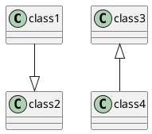

泛化（继承）用**实线 + 空心三角**表示，三角指向父类：`--|>` 表示左侧子类指向右侧父类，`<|--` 表示右侧子类指向左侧父类。

### 方案

**目标：** 仅“导出/渲染”路径——读取 VP 中的泛化关系，在类图中渲染为“实线 + 目标端空心三角”的 `--|>` / `<|--`。**不涉及导入。**

**现状分析（已核对源码）：**
- 渲染基础已具备：`PumlDiagram.writeEdge(PumlEdgeEnd, PumlEdgeEnd, LineStyle, String name, NameDirection direction)`（src/.../outputmodel/PumlDiagram.java，#9 已完成）的 `LineStyle.SOLID("--")` 与 `PumlEdgeEnd.ShapeKind`（`TRIANGLE("|>")`、`REVERSE_TRIANGLE("<|")`）已存在（src/.../outputmodel/PumlEdgeEnd.java），二者组合即可生成空心三角连线。
- 新输出模型中目前**没有**泛化的模型类、`MyElementType` 或导出器：`PumlElementExporterFactory`（src/.../outputmodel/pumelementexporter/PumlElementExporterFactory.java）目前注册了 ASSOCIATION / CLASS / PACKAGE / MODEL / RELATIONSHIPS / USE_CASE / UNIMPLEMENTED_ELEMENT，未含泛化。
- 旧 `MyRelationship_old.toExportFormat()`（src/.../myuml_old/mycommon_old/MyRelationship_old.java）有 `Generalization → <|--` 分支，但属于旧导出路径，不被新流水线消费，需要在新架构补齐。

**设计图（泛化导出相关模块）：**

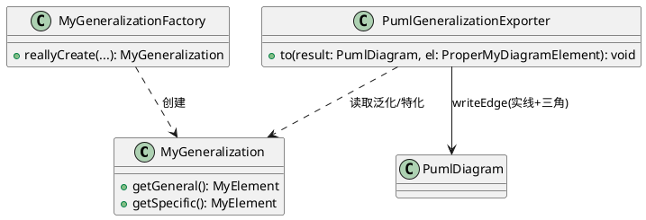

**实施步骤（每步可独立验证）：**

1. **建模（领域模型层）。**
   - 方案：新建 `MyGeneralization extends MyElement`，持有 general / specific（各为一个 `MyElement_old2`），并提供 `getGeneral()` / `getSpecific()`（以及对应的 setter）。在 `MyElementType`（.../myuml/myelement/MyElementType.java）新增 `GENERALIZATION(MODEL_TYPE_GENERALIZATION, ".generalization")` 枚举项。
   - 理由：泛化在 UML 语义上不同于关联/依赖，独立建模便于后续导入与发展；字段命名用 UML 规范术语 `general`（一般/父类）/ `specific`（特化/子类），**避免使用 `parent`/`child`**，以免与 VP API 的 parent/child 语义混淆。
   - 验证：为 `MyGeneralization` 及工厂写基础单元测试（构造、getter、类型后缀）。

2. **读取（工厂/访问器）。**
   - 方案：新建 `MyGeneralizationFactory`（参考 `MyDependencyFactory`，src/.../mydependency/），用 `(IGeneralization) vpElement` 强转，再经 `((IRelationship) vpGeneralization).getFrom()/getTo()` 获取两个端点。
   - **方向判定研究结论（已核验）：** `IGeneralization` 无专属方向方法（javap 确认），只继承 `ISimpleRelationship → IRelationship` 的 `getFrom()/getTo()`。旧 `MyRelationship_old.toExportFormat()` 的 Generalization 分支固定输出 `source <|-- target`（`source = relationship.getFrom()`，三角在 getFrom 侧/左），而 PlantUML 中 `<|--` 的空心三角指向父类，因此 **VP 泛化的 `getFrom()`=父类(general)、`getTo()`=子类(specific)**。方向恒定，**只有 getGeneral→general、getSpecific→specific 一种映射，无需考虑正向/反向交换**（PlantUML 的 `--|>` 与 `<|--` 语义等价，均三角指父，统一渲染为其中一种即可）。
   - 说明：VP SDK 的 `IGeneralization` 已由 javap 确认存在且继承链含 `getFrom()/getTo()`（openapi.jar）。
   - 验证：用桩数据断言 `getGeneral()`/`getSpecific()` 正确提取。

3. **导出渲染（输出模型层）。**
   - 方案：新建 `PumlGeneralizationExporter`，`to(...)` 中把 general 放 from、specific 放 to，调用 `writeEdge` 生成实线（`LineStyle.SOLID`）+ **from 端 `REVERSE_TRIANGLE("<|")`**，输出 `general <|-- specific`（三角指向父类）。
   - **方向判定逻辑：** 依据上述研究结论，`getGeneral()` 恒放连接线左端、`getSpecific()` 恒放右端，三角固定在 general（父）端，即始终渲染为 `父 <|-- 子`。**恒只有这一种方向，不需要根据几何/绘制方向做正反向交换**（PlantUML 中 `--|>` 与 `<|--` 语义等价，都表示左侧父右侧子或反之，三角恒指父；统一输出 `<|--` 即可完整表达继承关系）。
   - 理由：与关联渲染复用同一 `writeEdge` 端点机制（role/multiplicity 标签、方向符号），风格统一。
   - 验证：为导出器写单元测试，断言 `父 <|-- 子`（general=父放 from、specific=子放 to），并覆盖需求中两种输入（VP from=父/to=子 与 from=子/to=父 均归一为 `父 <|-- 子`）与需求和 VP 中方向一致。

4. **注册与接线（工厂）——三处登记，缺一不可。**
   - 方案：
     - 元素工厂：在 `MyElementFactoryFactory`（.../myuml/myelement/MyElementFactoryFactory.java）构造器注入 `MyGeneralizationFactory` 并 `register(MyElementType.GENERALIZATION, myGeneralizationFactory)`。
     - 图元类型：在 `DiagramElementType`（.../mydiagram/mydiagramelement/DiagramElementType.java）新增 `GENERALIZATION(SHAPE_TYPE_GENERALIZATION, Kind.EDGE)`（`SHAPE_TYPE_GENERALIZATION` 属于 `IShapeTypeConstants`，javap 已确认存在）。
     - 输出导出器：在 `PumlElementExporterFactory`（.../outputmodel/pumelementexporter/PumlElementExporterFactory.java）构造器注入 `PumlGeneralizationExporter` 并 `register(MyElementType.GENERALIZATION, generalizationExporter)`。
   - 验证：`MyElementFactoryFactory`/`PumlElementExporterFactory` 相关测试验证可 `of(GENERALIZATION)` 取到工厂/导出器（而非回退 Unimplemented / 抛 BugException）；整体 `mvn test` 无回归。

5. **集成验证。**
   - 验证：手动在 VP 中建立若干继承关系导出，检查 `.puml` 渲染为 `--|>` / `<|--` 且三角指向父类；用 PlantUML 预览确认可读、方向正确。

**说明/边界：** 本条目不在导入流水线解析 `--|>`；`MyElementType.GENERALIZATION` 仅为导出而增设。若同一泛化在线两端带泛型/立体类型，与 #18/#19 的关系需在后续条目统一处理（此处先不做）。


## 12 类的属性 Attribute
- 状态：待方案设计

### 需求

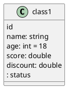
- 属性的名称、类型、可见性都可省略

### 方案

**目标：** 仅“导出/渲染”路径——读取 VP 类模型中的属性，渲染为 PlantUML 类体成员行（如 `id`、`name: string`、`age: int = 18`、`: status`）。**不涉及导入。** 名称/类型/初始值/可见性均可按字段有无省略。此处的成员渲染框架同时被 #13（操作）与 #14（可见性）复用。

**现状分析（已核对源码）：**
- 新领域模型中已存在独立的 `MyAttribute`（src/.../myclassifier/MyAttribute.java）与 `MyOperation`（src/.../myclassifier/MyOperation.java），但目前**没有任何流水线消费它们**；`MyClass`（src/.../myclassifier/MyClass.java）仍持有旧模型的 `List<MyAttribute_old> attributes` / `List<MyOperation_old> operations`。新的 `MyAttribute`/`MyOperation` 与旧版除包名、类名外完全一致（字段：name / visibility / type(initialValue) / isStatic；operation 另有 returnType / isAbstract / parameters）。
- 新导出渲染 `PumlBlockExporter.to(...)`（src/.../outputmodel/pumelementexporter/PumlBlockExporter.java）对类/命名空间/模型等仅执行 `beginBlock()` → 遍历 `subShapes`（子形状）→ `endBlock()`。**类的属性/操作并非子形状，因此当前类体完全为空**；这正是本条要补齐的缺口。
- VP API 提取来源已确认（旧 `OldClassDiagram.extractAttributes/extractOperations`，src/.../mydiagram_old/OldClassDiagram.java:249,268）：`IClass.attributeIterator()` / `IClass.operationIterator()`、`IAttribute.getVisibility()/getName()/getTypeAsString()/getInitialValueAsString()/getScope()`、`IOperation.getVisibility()/getName()/getReturnTypeAsString()/isAbstract()/getScope()/parameterIterator()`、`IParameter.getName()/getTypeAsString()/getDefaultValueAsString()`。
- 可见性取值：VP 的 `getVisibility()` 返回字符串（`public/private/protected/package`），旧 `PlantUMLWriter.writeVisibility`（src/.../writers_old/PlantUMLWriter.java:62）已给出映射：public→`+`、private→`-`、protected→`#`、package→`~`、其余→空。（可见性映射的详细设计见 #14。）

**设计图（类体成员渲染相关模块）：**

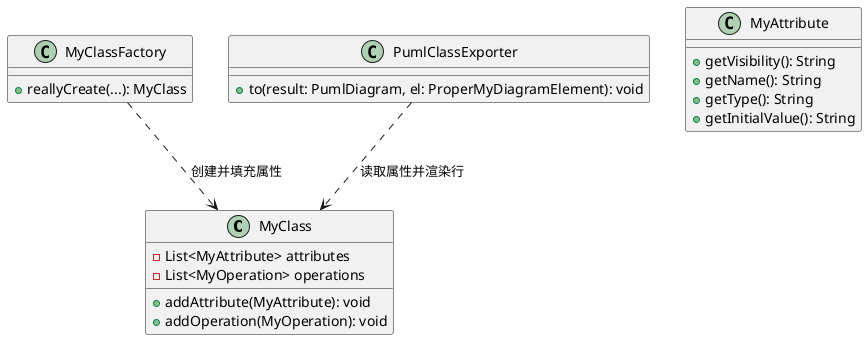

**实施步骤（每步可独立验证）：**

1. **建模（领域模型层）。**
   - 方案：将 `MyClass`（src/.../myclassifier/MyClass.java）中承载成员的两个集合由 `List<MyAttribute_old>` / `List<MyOperation_old>` **替换为 `List<MyAttribute>` / `List<MyOperation>`**（均来自 `...myclassifier` 包），并相应更新 `addAttribute/addOperation/getAttributes/setAttributes/getOperations/setOperations` 签名。删除对 `...myuml_old.myclass_old.MyAttribute_old/MyOperation_old` 的 import。
   - 理由：新 `MyAttribute`/`MyOperation` 已具备所需全部字段（name/visibility/type/initialValue/isStatic；returnType/isAbstract/parameters），替换旧类型即可让类体在新导出链路上被携带，同时保持两个模型类无需改动。
   - 验证：为 `MyClass` 写单元测试，断言 `getAttributes()/getOperations()` 能存入并取回 `MyAttribute`/`MyOperation` 实例（含参数列表）。

2. **读取（工厂/访问器）。**
   - 方案：在 `MyClassFactory.reallyCreate(...)`（src/.../myclassifier/MyClassFactory.java）中，因当前参数 `vpElement` 为 `IModelElement`，先强转为 `IClass`，再遍历 `attributeIterator()` 构造 `MyAttribute`、遍历 `operationIterator()` 及其 `parameterIterator()` 构造 `MyOperation`，调用 `myClass.addAttribute/addOperation` 填入后再返回。
   - 构造映射（与旧实现保持一致，保证往返字段完整）：
     - 属性：`new MyAttribute(attr.getVisibility(), attr.getName(), attr.getTypeAsString(), attr.getInitialValueAsString(), attr.getScope())`。
     - 操作：`new MyOperation(op.getVisibility(), op.getName(), op.getReturnTypeAsString(), op.isAbstract(), 参数列表, op.getScope())`；参数经 `parameterIterator()` 构造 `new Parameter(p.getName(), p.getTypeAsString(), p.getDefaultValueAsString())`。
   - 说明：可见性、初始值、类型缺省时对应 getter 可能返回空字符串，构造函数内部已处理（type 为空则置 null，initialValue 为空则置 null），渲染时按空值自动省略该段，无需额外分支。
   - 验证：用桩 `IClass` 断言提取到的 `MyAttribute`/`MyOperation` 字段正确（名称/类型/初值/可见性/静态/返回类型/参数默认值）。

3. **导出渲染（输出模型层）。**
   - 方案：让类体成员随块渲染输出。在 `PumlBlockExporter` 增加一个**可覆写**的成员渲染钩子（默认空实现，供 class 以外类型如 namespace/model 继承而不受影响），在 `beginBlock()` 之后、遍历 subShapes 迭代体内部之前（或紧接 beginBlock 之后）调用；`PumlClassExporter`（src/.../pumelementexporter/PumlClassExporter.java）覆写该钩子，把 `MyClass` 的属性和操作渲染为一个缩进层的 PlantUML 成员行。
   - 属性行格式（各段按字段有无省略）：`<可见性符号> <{static}>? <名称> [: <类型>] [= <初始值>]`。
     - 对应需求：`id`（仅名称）、`name: string`（名+类型）、`age: int = 18`（名+类型+初值）、`: status`（仅类型，名称为空时只输出 `: type`）、`discount: double`。
   - 操作行格式：`<可见性符号> <{abstract}>? <{static}>? <名称>(<参数列表>) [: <返回类型>]`，参数列表内每项 `名称[: 类型][= 默认值]`，逗号分隔。
     - 对应需求：`open(): void`、`close(): void`、`log(message: string): void`（含参）、`save(file: string): boolean`、`version(): string`。
   - 行文本写入复用 `result.writeTerminalShape(String)`（src/.../outputmodel/PumlDiagram.java:52）——它在当前缩进层追加一条语句，天然落在 `{ }` 内（因为 beginBlock 后已 indent 一层）。
   - 理由：与泛化/依赖导出一致，通过 exporter 渲染到 `PumlDiagram` 语句列表；钩子方式避免污染 namespace/model 的渲染。
   - 验证：为 `PumlClassExporter` 写单元测试，构造含属性/操作的 `ProperMyDiagramElement`，断言生成的类体行与需求中的 PlantUML 一致（含空白成员组合、`{static}`/`{abstract}`、参数默认值）。

4. **注册与接线（工厂）。**
   - 方案：本条不新增 `MyElementType`/`DiagramElementType`/新导出器类（类的类型 CLASS 早已登记），仅需确认 `MyClassFactory`（读取阶段填充成员）与 `PumlClassExporter`（渲染钩子）被正确注入。若 `MyClassFactory` 的 `reallyCreate` 签名需扩展（例如需额外注入 `IClass` 相关依赖），在 `MyElementFactoryFactory`（.../myuml/myelement/MyElementFactoryFactory.java）保持既有注册即可，无新增登记。
   - 验证：既有 `MyDiagramFactoryTest` 及整体 `mvn test` 无回归。

5. **集成验证。**
   - 验证：手动在 VP 中为类添加若干属性（不同名/类型/初值组合）导出，检查 `.puml` 类体渲染与需求一致；用 PlantUML 预览确认可读、缩进正确。

**说明/边界：** 本条目仅导出渲染属性，不涉及导入解析（PlantUML 侧 `{field}`）；可见性符号映射、操作专属细节与极简字段（仅类型 `: status`）分别在 #13/#14 承接。枚举字面量（`enumerationLiteralIterator`）不在本条范围（若 VP 类为枚举，其字面量按旧实现同样渲染为属性行，此处先不做，留待枚举条目）。类体成员的“值”“引号包裹特殊字符”等格式化沿用 `formatName` 类清理规则（已在导出器族中体现），本条仅保证基础名称直出。

## 13 类的操作 Operation
- 状态：待方案设计

### 需求

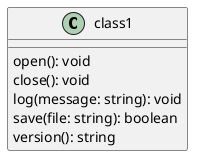

### 方案

**目标：** 仅“导出/渲染”路径——读取 VP 类模型中的操作（含参数），渲染为 PlantUML 类体操作行（如 `open(): void`、`log(message: string): void`、`save(file: string): boolean`）。**不涉及导入。** 本条在上条目 #12 建立的“类体成员渲染框架”基础上承接操作的专属渲染；可见性符号见 #14。

**现状分析（已核对源码）：**
- 领域模型 `MyOperation`（src/.../myclassifier/MyOperation.java）已具备全部所需字段：`visibility / name / returnType / isAbstract / isStatic / parameters`（参数为内部静态类 `MyOperation.Parameter`，含 `name / type / defaultValue`），并提供 `addParameter(...)` / `getParameters()`。
- `MyOperation` 目前无流水线消费（与 `MyAttribute` 一样），需随 #12 把 `MyClass` 成员集合切到新类型后，于 `MyClassFactory.reallyCreate` 中从 `IClass.operationIterator()` + `IOperation.parameterIterator()` 填充（提取代码见 #12 步骤 2，此处不再重复）。
- 旧 `PlantUMLWriter.writeAttributesAndOperations`（src/.../writers_old/PlantUMLWriter.java:97-136）已给出操作行渲染规则：
  - 前缀：`<可见性符号>`，其后 `{abstract} `、`{static} ` 按需追加；
  - 名称：`<名称>(`；
  - 参数：逐项 `<参数名>[: <类型>][= <默认值>]`，`类型`/`默认值` 为空时省略，多项以 `, ` 分隔；
  - 收尾：`)`，返回类型非空时追加 `: <返回类型>`。
- 渲染写入沿用 #12 在 `PumlClassExporter` 提供的成员钩子，复用 `PumlDiagram.writeTerminalShape(String)` 在当前缩进层输出操作行。

**设计图（操作渲染）：**

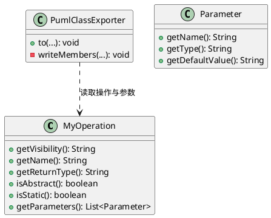

**实施步骤：**

1. **读写链路（已并入 #12）。** `MyClassFactory.reallyCreate` 遍历 `IClass.operationIterator()`，每项构造 `new MyOperation(op.getVisibility(), op.getName(), op.getReturnTypeAsString(), op.isAbstract(), 参数List, op.getScope())`，再逐参数 `addParameter(new Parameter(p.getName(), p.getTypeAsString(), p.getDefaultValueAsString()))`，最后 `myClass.addOperation(op)`。此步骤随 #12 一并落地，本条不重复编码。

2. **操作行渲染（输出模型层）。**
   - 方案：在 `PumlClassExporter` 的成员钩子中，先渲染属性（#12），再渲染操作：对 `MyClass.getOperations()` 中的每个 `MyOperation` 生成一行：
     ```
     <可见性符号><{abstract} ><{static} >名称(参数1, 参数2, ...)[: 返回类型]
     ```
   - 参数项：`参数名`，若 `getType()` 非空则 `: 类型`，若 `getDefaultValue()` 非空则 ` = 默认值`。
   - 对应需求输出：`open(): void`、`close(): void`、`log(message: string): void`、`save(file: string): boolean`、`version(): string`。
   - 理由：与旧 writer 规则一致，保证与旧导出同款可读语法。
   - 验证：为 `PumlClassExporter` 补操作相关单测，构造一个含二元参数+返回类型、一个含缺省参数、一个无返回类型的操作，断言生成的操作行与需求逐字一致，且多个参数以 `, ` 连接、`{abstract}`/`{static}` 前缀正确。

3. **接线与回归。** 操作渲染随 #12 的 `MyClassFactory`（读取）与 `PumlClassExporter`（渲染）自动生效，无新增登记；整体 `mvn test` 无回归。

**说明/边界：** 本条目仅导出渲染操作，不涉及导入解析（PlantUML 侧 `{method}`）。参数默认值 `= ...`、`{abstract}`/`{static}` 均按 VP 模型是否提供字段决定是否输出；`{abstract}` 由 `IOperation.isAbstract()`、`{static}` 由 `scope=="classifier"` 判定。可见性符号映射见下条目 #14。

## 14 可见性 Visibility
- 状态：待方案设计
- 注：通过前缀符号表示：`+` 公有、`-` 私有、`#` 保护、`~` 包级

### 需求

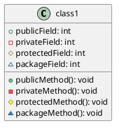

### 方案

**目标：** 为类体成员（属性 #12、操作 #13）的可见性提供“VP 可见性字符串 → PlantUML 前缀符号”的映射，并在导出渲染时嵌入成员行首。可见性可省略（VP 未提供或值不在映射表时输出空前缀）。**不涉及导入。**

**现状分析（已核对源码）：**
- VP 侧 `IAttribute.getVisibility()` / `IOperation.getVisibility()` 返回可见性字符串（如 `public/private/protected/package`，可能为空）。旧 `PlantUMLWriter.writeVisibility(...)`（src/.../writers_old/PlantUMLWriter.java:62-79）已实现映射：
  - `private`→`-`、`protected`→`#`、`package`→`~`、`public`→`+`，其余（含空/未知值）→空字符串。
- 需求所需符号：`+` 公有、`-` 私有、`#` 保护、`~` 包级，与上述映射一一对应（需求列出的 `publicField/privateField/protectedField/packageField` 及 `publicMethod/...` 正是 `public/private/protected/package` 的 PlantUML 名称，前缀符号相同）。
- 该映射属于**渲染细节**，应放在输出模型层的成员渲染处（`PumlClassExporter`），而非领域模型 `MyAttribute`/`MyOperation`（它们持原始可见性字符串，便于将来导入）。

**设计图（可见性映射）：**

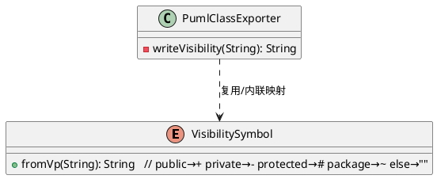

**实施步骤：**

1. **映射逻辑（输出模型层）。**
   - 方案：在 `PumlClassExporter`（或输出模型包内一个小的可见性辅助）提供 `String visibilityToSymbol(String vpVisibility)`：`public→+`、`private→-`、`protected→#`、`package→~`、其余（含 null/空/未知）→`""`。
   - 理由：与旧 `writeVisibility` 行为对齐；作为纯函数易于单测，不污染领域模型。
   - 验证：为此映射写单测，覆盖四种可见性 + 空字符串 + 未知值（断言未知与空返回空前缀）。

2. **接入类体渲染。**
   - 方案：在 #12/#13 生成的属性行与操作行的行首调用该映射，若返回值非空则输出 `符号 + " "`；可见性省略（返回空）时行首为空，随后的 `{static}`/`{abstract}`/名称正常输出。
   - 对应需求输出对齐：
     - 属性：`+ publicField: int`、`- privateField: int`、`# protectedField: int`、`~ packageField: int`（可见性+名称+类型）。
     - 操作：`+ publicMethod(): void`、`- privateMethod(): void`、`# protectedMethod(): void`、`~ packageMethod(): void`。
   - 验证：为 `PumlClassExporter` 补单测，构造带四种可见性的属性与操作，断言行首符号与需求一致；再构造可见性为空/未知的成员，断言无符号前缀（对应 “属性名称、类型、可见性都可省略”）。

3. **接线与回归。** 可见性映射随 #12/#13 的成员钩子一并落地，无新增登记；整体 `mvn test` 无回归。

**说明/边界：** 本条目仅处理可见性前缀的渲染，不涉及导入方向（VP 侧可见性的写入在导入条目另行设计）。`{static}`/`{abstract}` 前缀与可见性符号的拼接顺序沿用旧 writer（可见性在前，其后依次 `{static}`/`{abstract}`）。未知或缺失的可见性一律输出空前缀，以保证“可见性可省略”。
- 状态：待方案设计


## 15 类、包的泛型 Stereotype
- 状态：待方案设计

### 需求

```plantuml
@startuml
class class1 <<service>> {}
abstract class class2 <<repository>> {}

package package1 <<framework>> {
    class class3 {}
}
@enduml
```

### 方案

**目标：** 仅“导出/渲染”路径——读取 VP 类/包/模型元素上所施加的 stereotype（泛型名），在 PlantUML 块声明的块名后渲染为一组 `<<泛型名>>` 后缀（如 `class "class1" as class1 <<service>>`、`abstract class "class2" as class2 <<repository>>`、`namespace "package1" as package1 <<framework>>`）。**不涉及导入。** 泛型渲染复用 `PumlBlockExporter` 的块声明机制，同时为需求中的 `abstract class` 补齐抽象类判定。

**现状分析（已核对源码）：**
- 块渲染基础已具备：`PumlBlockExporter.export(...)`（src/.../outputmodel/pumelementexporter/PumlBlockExporter.java:18）统一调用 `result.beginBlock(getBlockType(), vpElement.getName(), getPumlAlias(vpElement), getBlockSuffix())`。其中 `getBlockSuffix()`（默认返回空串）就是“在块声明末尾追加内容”的现成钩子——`PumlModelExporter`（同包）已覆写它返回硬编码 `<<model>>`（src/.../PumlModelExporter.java:20）。
- 泛型读取 API 已确认（javap openapi.jar）：`IModelElement` 提供 `String[] toStereotypeArray()`（元素上施加的泛型名数组，可空/可为空）及 `int stereotypeCount()` / `Iterator stereotypeIterator()`；`IClass` 提供 `boolean isAbstract()`。`IClass`、`IPackage`、`IModel` 均继承自 `IModelElement`，故类、包、模型三处统一经 `toStereotypeArray()` 读取即可。
- 块类型现状：`PumlClassExporter.getBlockType()` 固定返回 `"class"`，**未区分抽象类**；`PumlPackageExporter.getBlockType()` 与 `PumlModelExporter.getBlockType()` 均返回 `"namespace"`（包用 namespace 关键字，与 #1 包条目既有实现一致）。
- 泛型名直接原样输出：`toStereotypeArray()` 返回的泛型名本身即 PlantUML 合法文本，置于 `<<`、`>>` 之间，**无需净化**（泛型名中的空格/标点等字符可保留，PlantUML 徽标可正常显示）。

**设计图（stereotype 渲染相关模块）：**

```plantuml
@startuml
class PumlBlockExporter {
  + export(result: PumlDiagram, vp: IDiagramElement): void
  # renderStereotypes(vp: IModelElement): String
  # getBlockType(): String
  # getBlockSuffix(): String
}
class PumlClassExporter {
  # getBlockType(): String   // class / abstract class
  # buildBlockType(vp): String
}
class PumlPackageExporter {
  # getBlockType(): String   // namespace
}
PumlClassExporter --|> PumlBlockExporter
PumlPackageExporter --|> PumlBlockExporter
@enduml
```

**实施步骤（每步可独立验证）：**

1. **泛型后缀渲染（输出模型层，核心钩子）。**
   - 方案：在 `PumlBlockExporter` 增加一个受保护方法 `String buildBlockSuffix(IModelElement vpElement)`（默认把 `getBlockSuffix()` 与 `renderStereotypes(vpElement)` 拼接），并在 `export(...)` 中把 `getBlockSuffix()` 的实参改为 `buildBlockSuffix(vpElement)`。
   - `renderStereotypes(vpElement)` 的实现：调用 `vpElement.toStereotypeArray()`，若 `null`/长度为 0 则返回空串；否则对每个泛型名**原样**输出 `<<"泛型名">>`（无需净化），多项之间以单个空格连接，最后整体拼在 `getBlockSuffix()`（固定原型，如 model 的 `<<model>>`）之后——保证既输出元素自有泛型，又保留子类硬编码的原型。
   - 理由：复用现有 `beginBlock` 的 `blockSuffix` 参数，一处接入即对 class/package/model 全生效；子类既有 `getBlockSuffix()` 覆写不受影响。
   - 验证：为 `buildBlockSuffix`/`renderStereotypes` 写单元测试，覆盖：无泛型（返回空后缀）、单泛型、多泛型（空格分隔）、含空格/标点的泛型名（原样输出，不净化）、与 `getBlockSuffix()`（`<<model>>`）合并后的顺序。

2. **类：抽象类判定与泛型渲染（PumlClassExporter）。**
   - 方案：因 `getBlockType()` 无 `vpElement` 参数，改为在 `PumlBlockExporter.export(...)` 中调用一个可覆写、可访问 `vpElement` 的 `String buildBlockType(IModelElement vpElement)`（默认返回 `getBlockType()`），并让 export 用它替代 `getBlockType()`；`PumlClassExporter` 覆写 `buildBlockType`：若 `((IClass) vpElement).isAbstract()` 则返回 `"abstract class"`，否则 `"class"`。
   - 泛型部分随步骤 1 的 `buildBlockSuffix` 自动落到类声明的块名后，输出形如 `class "class1" as class1 <<service>> {` 或 `abstract class "class2" as class2 <<repository>> {`。
   - 理由：与当前重构后的“直读 VP 原生模型”一致；abstract 判定依赖具体 vpElement，故用可访问参数的方法。
   - 验证：为 `PumlClassExporter` 补单测，桩 `IClass`（带 `isAbstract()` 与 `toStereotypeArray()`），断言：普通类→`class ... <<service>>`；抽象类→`abstract class ... <<repository>>`；无泛型的抽象类→`abstract class ...`（无后缀）；无泛型普通类→`class ...`（无后缀，行为不变）。

3. **包与模型：泛型渲染（PumlPackageExporter / PumlModelExporter）。**
   - 方案：无需改 `getBlockType()`（保持 namespace）。泛型经步骤 1 的 `buildBlockSuffix` 自动叠加：`PumlPackageExporter` 渲染 `namespace "package1" as package1 <<framework>> {`；`PumlModelExporter` 渲染 `<固定 <<model>>>` 与模型自有泛型合并（如模型带自有泛型时输出 `namespace ... <<model>> <<自有泛型>>`）。
   - 理由：统一走 `buildBlockSuffix`，两处无需各自写逻辑。
   - 验证：为 `PumlPackageExporter`/`PumlModelExporter` 补单测，断言包/模型带泛型时块头正确、无泛型时无后缀、`<<model>>` 固定原型仍保留。

4. **接线与回归。** 本条不新增 `ViElementType`/`DiagramElementType`/新导出器类（CLASS/PACKAGE/MODEL 类型早已登记、仍按 `getShapeType()` 分发），仅 `PumlBlockExporter`/`PumlClassExporter` 的钩子与 `PumlPackageExporter`/`PumlModelExporter` 校验；整体 `mvn test` 无回归。

5. **集成验证。**
   - 验证：手动在 VP 中为类（含抽象类）与包设置若干 stereotype 后导出，检查 `.puml` 块声明后的 `<<泛型>>` 渲染与需求一致；用 PlantUML 预览确认泛型徽标可读、多泛型显示正常。

**说明/边界：** 本条目仅处理类、包、模型块声明上的 stereotype 渲染，不涉及关系（关联/依赖/泛化）连线上的 stereotype（见 #16），也不涉及导入方向对 `<<...>>` 的解析。`<<model>>` 作为模型的固定原型仍然保留（叠在模型自有泛型之前）。泛型名直接原样置于 `<<`、`>>` 之间输出，不做任何净化。

## 16 关系的泛型 Stereotypes of Relationships
- 状态：待方案设计

### 需求

```plantuml
@startuml

class1 -- class2: name <<Stereotype1>> >
class3 -- class4: <<Stereotype2>> 
class5 ..> class6: <<Stereotype3>>
class7 <|-- class8: <<Stereotype4>>

@enduml
```

### 方案

**目标：** 仅“导出/渲染”路径——读取 VP 关联/依赖/泛化关系上施加的 stereotype（泛型名），渲染到 PlantUML 连线的 `: 标签` 中，并支持两种形态：`名称 泛型`（如 `class1 -- class2: name <<Stereotype1>> >`）、仅泛型无名称（如 `class5 ..> class6: <<Stereotype3>>`）。泛型名原样输出、不净化（沿用 #15 结论），**不涉及导入**。

**现状分析（已核对源码）：**
- 三个关系 exporter 均继承 `PumlElementExporter`：`PumlAssociationExporter`（src/.../PumlAssociationExporter.java:33）、`PumlDependencyExporter`（L31）、`PumlGeneralizationExporter`（L27），各自的 `export()` 均通过 `result.writeEdge(from, to, lineStyle, name, direction)` 输出一条连线，当前 `name` 参数只传关系的 `getName()`。
- `PumlDiagram.writeEdge`（src/.../PumlDiagram.java:80）对 `name` 的语义：**`name` 非空（非 blank）才输出 `: 标签`，并按 `direction` 在标签后追加阅读三角（FROM_TO→`>`、TO_FROM→`<`、NONE→无三角）**。因此把“名称+泛型”的合并串作为 `name` 传入，即可同时自然输出泛型徽标与阅读三角，**`writeEdge` 无需改动、兼容原有调用点**（空名/无泛型时仍省略标签）。
- 泛型读取 `renderStereotypes(IModelElement)` 现位于 `PumlBlockExporter`（供 #15 的 class/package/model 使用），而关系 exporter 不继承 `PumlBlockExporter`；需把该方法**提升到公共基类 `PumlElementExporter`**（block 与关系共同继承，一处实现）。
- 读取 API 已确认（javap openapi.jar）：`IGeneralization`、`IDependency`、`IAssociation` 均经 `IRelationship`→`IModelElement` 继承 `Iterator stereotypeModelIterator()`（返回 `IStereotype`，含 `getName()`），三类关系可统一用同一读取方法、无需类型强转。

**设计图（关系泛型渲染相关模块）：**

```plantuml
@startuml
class PumlElementExporter {
  # renderStereotypes(vp: IModelElement): String
}
class PumlBlockExporter {
  # buildBlockSuffix(vp: IModelElement): String
}
class PumlAssociationExporter {
  + export(result, vp: IDiagramElement): void
}
class PumlDependencyExporter {
  + export(result, vp: IDiagramElement): void
}
class PumlGeneralizationExporter {
  + export(result, vp: IDiagramElement): void
}
PumlBlockExporter --|> PumlElementExporter
PumlAssociationExporter --|> PumlElementExporter
PumlDependencyExporter --|> PumlElementExporter
PumlGeneralizationExporter --|> PumlElementExporter
@enduml
```

**实施步骤（每步可独立验证）：**

1. **泛型渲染工具上移（输出模型层）。** 把 `renderStereotypes(IModelElement vpElement)` 从 `PumlBlockExporter` 移到公共基类 `PumlElementExporter`（方法体不变：`stereotypeModelIterator()` 遍历 `IStereotype`、`getName()` 原样输出 `<</名/>>`、空格分隔、空名跳过、无泛型返回空串）。`PumlBlockExporter` 继承它即可，`buildBlockSuffix` 逻辑不变。此步为纯重构，不改变 #15 行为。
   - 验证：既有的 `PumlBlockExporterStereotypeTest` 全部通过（`renderStereotypes`/`buildBlockSuffix` 断言不变），证明行为未回归。

2. **关系标签合并（各关系 exporter）。** 在三个关系 exporter 中各加一个私有小方法，把“关系名称 + 泛型后缀”合并为单个标签串：若 `getName()` 非空且 `renderStereotypes` 非空则拼 `name <<...>>`；仅泛型则只有 `<<...>>`；都为空则空串。随后将 `export()` 里 `writeEdge(...)` 的 `name` 实参从 `xxx.getName()` 改为该合并串。`lineStyle`/`ShapeKind`/`direction` 保持各自现状（关联 SOLID `--`、依赖 DASHED `..>` + ARROW、泛化 SOLID `<|--` + REVERSE_TRIANGLE）。
   - 理由：`writeEdge` 已按 name 非空逻辑覆盖“名称+泛型+三角”与“仅泛型”两形态，关系侧只需负责组装标签串。
   - 验证：为三个关系 exporter 各写单测，桩关系（含 `getName()`、`getFrom()`/`getTo()`/`getFromEnd()`/`getToEnd()`、`stereotypeModelIterator()`），断言输出行：
     - 关联带名称+泛型+方向 → `class1 -- class2: name <<Stereotype1>> >`
     - 关联仅泛型无名称（方向 NONE）→ `class3 -- class4: <<Stereotype2>>`
     - 依赖仅泛型 → `class5 ..> class6: <<Stereotype3>>`
     - 泛化仅泛型 → `class7 <|-- class8: <<Stereotype4>>`
     - 名称+泛型都为空 → 无冒号标签（行为不变）。

3. **接线与回归。** 本条不新增 `ViElementType`/`DiagramElementType`/新导出器类（ASSOCIATION/DEPENDENCY/GENERALIZATION 的类型早已登记、仍按 `getShapeType()` 分发），仅上移共用方法与三个关系 exporter 的标签组装；整体 `mvn test` 无回归（原 51 个测试保持通过）。

4. **集成验证。**
   - 验证：手动在 VP 中为关联/依赖/泛化设置若干 stereotype 后导出，检查 `.puml` 连线 `: 标签` 处的泛型渲染与需求一致；用 PlantUML 预览确认泛型徽标与阅读三角正常显示、无名泛型连线无多余冒号。

**说明/边界：** 本条目仅处理关系连线上的 stereotype 渲染，不涉及导入方向对 `<<...>>` 的解析；类/包/模型块声明上的 stereotype 已在 #15 完成，两者互不影响。泛型名直接原样置于 `<<`、`>>` 之间输出，不做净化。阅读方向三角仍由 `writeEdge` 按 direction 派生，关系侧不改此语义。

## 18 接口实现 Implementation (常规方式)
- 状态：待方案设计

### 需求

```plantuml
@startuml
class class1 {}
class class2 {}

interface interface1 <<interface>> { }
interface interface2 <<interface>> {}

class1 ..|> interface1
interface2 <|.. class2

@enduml
```

### 方案
TODO

## 19 注释 Note

### 需求

用 `note` 为类、关系添加注释说明。

```plantuml
@startuml
class class1 {
}
class class2 {
}

note "UML Style" as N1


class2 .. N1
class1 .. N1

@enduml
```


```plantuml
@startuml
class class1 {
}
class class2 {
}

note "UML Style" as N1


class2 .. N1
class1 .. N1

@enduml
``

### 方案
TODO

## 20 枚举 Enumeration

### 需求

- `enum` 声明枚举，枚举值之间用逗号分隔,按UML的约定，应加 `<<enumeration>>` 关键字。

```plantuml
@startuml
enum Status <<enumeration>> {
    NEW
    ACTIVE
    CLOSED
}
@enduml
```

- 枚举也可以有属性和操作，如下例：
```plantuml
@startuml
enum Status <<enumeration>> {
    - name: string
    --
    + {static} valueOf(name: string): Status
    --
    NEW
    ACTIVE
    CLOSED
}
@enduml
```

### 方案
TODO
