# 类图 Class Diagram

## 1 包 package

- 状态：已完成

### 需求

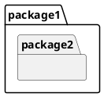
-注意： PlantUML 中的 "namespace" 才对应 UML package

### 方案
略

## 2 模型 Model

- 状态：已完成

### 需求

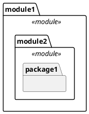

### 方案

略

## 3 类 Class

- 状态：已完成

### 需求

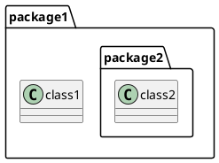

### 方案

略

## 4 关联 Association

- 状态：已完成

### 需求

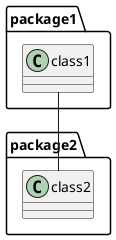

### 方案

略

## 5 多重性 Multiplicity

- 状态：已完成

### 需求

```plantuml
@startuml

namespace "package1" as package1{
class "class1" as package1__class1 {
}
}

namespace "package2" as package2 {
class "class2" as package2__class2 {
}
}

package1__class1 "1"--"0..1" package2__class2
package1__class1 "1"--"0..*" package2__class2
package1__class1 "*"--"1..*" package2__class2

@enduml
```

### 方案

略

## 6 导航 Navigation

- 状态：已完成

### 需求

```plantuml
@startuml
class1 "1"-->"0..1" class2
class3 "1"<--"0..*" class4
class5 "*"<-->"1..*" class6
class7 "*"x-->"1..*" class8
class9 "*"x--x"1..*" class10
class11 "*"--"1..*" class12
@enduml
```

### 方案

略

## 7 角色 Role

- 状态：已完成

### 需求

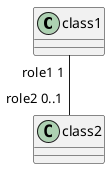

### 方案

略

## 8 聚合与组合 Aggregation & Composition

- 状态：已完成

### 需求

```plantuml
@startuml
class1 "1"*--"0..*" class2
class3 "1"o--"0..*" class4
@enduml
```
-注意： `*--` 表示组合（Composition），`o--` 表示聚合（Aggregation）

### 方案
略

## 9 关联名称 Association Name
- 状态：已完成

### 需求

```plantuml
@startuml
class1 "1"*--"0..*" class2: doSomething >
class3 "1"o--"0..*" class4: < doSomething
@enduml
```

关联名称（名称标签，如 `doSomething`）贴在关联线上，名称旁可带一个实心小三角（`>` 或 `<`），指示名称的**阅读方向**（对应 UML 中关联名称旁的小实心三角），而非位置记号。

### 方案

**目标：** 扩展导出渲染，使关联线可输出名称及阅读方向三角；不改动导入，仅触及输出模型层（`PumlDiagram`）与关联导出器（`PumlAssociationExporter`）、关联模型（`MyAssociation`）。

**现状分析（已核对源码）：**
- 关联线渲染集中在 `PumlDiagram.writeEdge(PumlEdgeEnd, PumlEdgeEnd, LineStyle)`（src/.../outputmodel/PumlDiagram.java:82）：目前把 role 与 multiplicity 合并成**每一端一个**引号标签，不输出关联名称，也不带方向三角。
- `PumlEdgeEnd.ShapeKind`（.../PumlEdgeEnd.java）表达的是**端点的导航符号**，与名称阅读方向三角是两个概念，不可混用。
- 阅读方向的真实数据来源是 VP 的 `IAssociation.getDirection()`，返回 `IAssociation.DIRECTION_FROM_TO` 或 `IAssociation.DIRECTION_TO_FROM`。
- `MyAssociation.getName()`（.../myassociation/MyAssociation.java:18 经 `MyElement`）已持有 VP 的关联名称；从 VP 获取关联名称时若返回 `null`，在读数层归一化为空串 `""`。

**设计图（导出器内部协作）：**

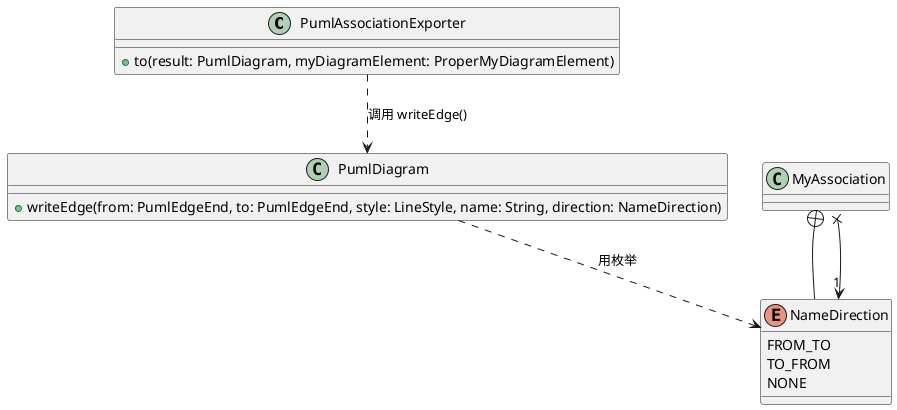

**实施步骤（每步可独立验证）：**

1. **定义阅读方向枚举（`MyAssociation` 内部类）。**
   - 方案：在 `MyAssociation` 中新增内部枚举 `NameDirection`，取值 `FROM_TO`、`TO_FROM`、`NONE`；其中 `NONE` 仅用作“无名称”时的占位符。
   - 理由：方向的语义（DIRECTION_FROM_TO / DIRECTION_TO_FROM）属于关联本身，作为 `MyAssociation` 的内部类最贴合领域模型，不放在 `PumlEdgeEnd` 上。
   - 验证：为 `MyAssociation` 写单元测试，断言该枚举的三个取值存在。

2. **读取层捕获方向并归一化（`MyAssociationFactory`）。**
   - 方案：在 `MyAssociationFactory`（src/.../myassociation/）读取 VP 关联时，取 `IAssociation.getDirection()`，映射为 `NameDirection.FROM_TO`/`TO_FROM`，两者之外归为 `NONE`；关联名称若返回 `null` 归一化为 `""`。
   - 验证：为工厂写单元测试，分别用 `DIRECTION_FROM_TO`、`DIRECTION_TO_FROM`、`null` 的桩断言方向与名称正确落值。

3. **渲染层签名改为 5 参数（`PumlDiagram`）。**
   - 方案：直接将 `writeEdge(PumlEdgeEnd, PumlEdgeEnd, LineStyle)` 扩展为 `writeEdge(PumlEdgeEnd, PumlEdgeEnd, LineStyle, String name, NameDirection direction)`，**不再保留 3 参数 API**（同一处调用点同步更新）。
   - 方法内部：判断 `name` 是否为空或空白（`null`/空串/纯空白）——
     - 为空或空白：按原有逻辑输出，不追加 `: `，也不输出方向三角；
     - 非空：追加 `: <name>`，并结合 `direction` 决定三角符号（详见步骤 4 的“`>` / `<` 选择规则”）。
   - 理由：名称是关联线的必备能力且只此一种通过途径，直接改签名避免维护两套 API。
   - 验证：对 `PumlDiagram` 写单元测试，覆盖“名称非空 + 方向 FROM_TO/TO_FROM”“名称为空串”“名称为纯空白”等分支。

4. **“`>` / `<`”选择算法。**
   - 说明：需求中方向箭头位于关联名称旁（`doSomething >` 或 `< doSomething`），表示名称的阅读方向；其数据来自 `IAssociation.getDirection()`。约定 `writeEdge(from, to)` 的 **from 恒在左、to 恒在右**，且 VP 的 `DIRECTION_FROM_TO`/`DIRECTION_TO_FROM` 的 from/to 与 `writeEdge` 传入的两端一致。
   - 规则（纯方向判断，不依赖端序）：
     - `FROM_TO`：阅读从左到右 → 输出 `name  >`（三角在名称右侧）；
     - `TO_FROM`：阅读从右到左 → 输出 `<  name`（三角在名称左侧）；
     - `NONE`：不输出三角。
   - 理由：因 from 恒在左且 VP 方向与端序一致，无需再判断端序，直接按方向选用符号即可；三角由“阅读方向”派生而非端点导航符号，故不复用 `PumlEdgeEnd.ShapeKind` 的 `ARROW/REVERSE_ARROW`。
   - 验证：用方向不同组合的桩数据断言输出三角朝向正确，并对照需求图（`doSomething >` 与 `< doSomething`）。

5. **导出器接线（`PumlAssociationExporter`）。**
   - 方案：`to(...)` 中调用 5 参数 `writeEdge`，传入 `association.getName()`（已归一化为 `""`）与 `association` 持有的 `NameDirection`；无名称时由第 3 步内部逻辑回退，保证旧用例（无名称）输出不变（如 `A -- B`）。
   - 理由：保持现有无名称关联输出兼容，避免破坏既有测试 `shouldOmitMultiplicityWhenEmpty` 等。
   - 验证：扩展 `PumlAssociationExporterTest`，新增“带名称→输出 `: name`”“带方向→输出对应三角”“名称空→无 `:`”等断言；跑该测试类。

6. **回归与集成验证。**
   - 验证：整体 `mvn test`（仓库内现有测试）确认无回归（注意同步更新调用 3 参数 `writeEdge` 的既有测试/调用点）；手动在 VP 中导出带名称/带方向、以及无数值关联，检查 `.puml` 可被 PlantUML 正确解析渲染。

**说明/边界：** 名称与多重性、角色分属不同标签位（名称在连线中央、role+multiplicity 在端），二者不冲突；名称为空/空白时不输出方向三角；`NONE` 仅作无名称时的占位。

## 10 依赖 Dependency
- 状态：已完成

### 需求
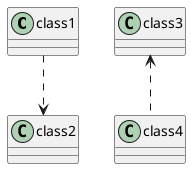

### 方案

**目标：** 仅“导出/渲染”路径——读取 VP 中的依赖关系，在类图中渲染为带方向的虚线箭头 `..>`。**不涉及导入。**

**现状分析（已核对源码）：**
- 新输出模型（`domain/outputmodel`）目前没有“依赖”对应的模型类、`MyElementType` 或导出器；`PumlElementExporterFactory`（src/.../outputmodel/pumelementexporter/PumlElementExporterFactory.java）目前注册了 ASSOCIATION / CLASS / PACKAGE / MODEL / RELATIONSHIPS / USE_CASE / UNIMPLEMENTED_ELEMENT，未含依赖。
- 旧 `MyRelationship_old.toExportFormat()`（src/.../myuml_old/mycommon_old/MyRelationship_old.java）里有 `case "Dependency": symbol = "..>"` 分支，但它属于旧导出路径，不被新流水线消费，因此需在新架构补齐。
- 渲染基础已具备：`PumlDiagram.writeEdge(PumlEdgeEnd, PumlEdgeEnd, LineStyle, String name, NameDirection direction)` 支持 `LineStyle.DASHED("..")` 与 `PumlEdgeEnd.ShapeKind.ARROW(">")`，组合即可生成“虚线 + 目标端箭头”的 `..>`（from 在左、to 在右，箭头贴合 to 端）。

**研究结论（已用 `javap` 反编译 VP SDK `openapi.jar` 核对）：**
- **接口**：VP 有独立依赖接口 `com.vp.plugin.model.IDependency`（继承 `IHasRelationshipBaseSimpleRelationship` → `ISimpleRelationship` → `IRelationship` → `IModelElement`）。
- **模型类型常量**：`IModelElementFactory.MODEL_TYPE_DEPENDENCY = "Dependency"`。
- **端点读取**：`IDependency.toFromRelationshipEndArray()` → `IRelationshipEnd[]`（源端）、`toToRelationshipEndArray()` → `IRelationshipEnd[]`（目标端）；每端 `IRelationshipEnd.getModelElement()` 返回该端绑定的分类器 `IModelElement`。因此 from = `toFromRelationshipEndArray()[0].getModelElement()`，to = `toToRelationshipEndArray()[0].getModelElement()`。
- **工厂注册**: `buildRoot` 须能用 modelType=`"Dependency"` 查得依赖工厂（见步骤 3）

**设计图（依赖导出相关模块）：**

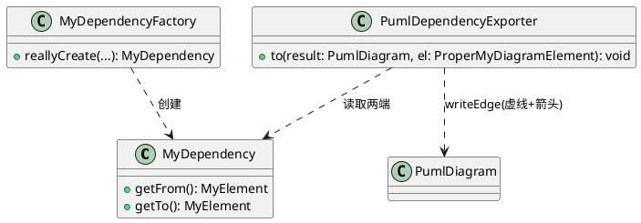

**实施步骤（每步可独立验证）：**

1. **建模（领域模型层）。**
   - 方案：新建 `MyDependency extends MyElement`，持有 from / to（各为一个 `MyElement`）。在 `MyElementType`（.../myuml/myelement/MyElementType.java）增加 `DEPENDENCY` 枚举项，绑定 VP 类型 `MODEL_TYPE_DEPENDENCY`。
   - 理由：依赖与关联在 UML 上是不同关系类型，独立建模便于后续导入与发展。
   - 验证：为 `MyDependency` 及工厂写基础单元测试（构造、getter、类型后缀、`vpModelTypeIs("Dependency")`）。

2. **读取（工厂/访问器）。**
   - 方案：新建 `MyDependencyFactory`（参考 `MyAssociationFactory`，src/.../myassociation/），`reallyCreate()` 中把 `IModelElement` 强转 `IDependency`：
     - `from = ((IDependency) vpElement).toFromRelationshipEndArray()[0].getModelElement()`
     - `to = ((IDependency) vpElement).toToRelationshipEndArray()[0].getModelElement()`
   - 验证：用桩 `IDependency` 断言 from/to 正确提取。

3. **注册依赖工厂（`MyElementFactoryFactory`）**
     - 方案：在 `MyElementFactoryFactory`（.../myuml/myelement/MyElementFactoryFactory.java）构造器注入 `MyDependencyFactory` 并 `register(MODEL_TYPE_DEPENDENCY, myDependencyFactory)`。
     - 理由：`buildRoot` 用 `getModelType()` 查工厂；当前 `MyElementFactoryFactory.of()` 对未注册类型会回退到 `UNIMPLEMENTED_ELEMENT` 工厂并 `log.warn`（不抛异常），注册后才不会把“依赖”误建成 UnimplementedElement。
     - 验证：单测验证 `of("Dependency")` 能取到 `MyDependencyFactory` 并创建元素。

4. **图元类型注册（`DiagramElementType`）。**
   - 方案：`MyDiagramElementFactory.createMyDiagramElement` 会用 `DiagramElementType.of(vpElement.getShapeType())` 记录图元类型（.../mydiagram/mydiagramelement/DiagramElementType.java），其 `Kind` 决定图元被 `MyDiagram.addSubDiagramElement` 归入 `subShapes` 还是 `subEdges`。依赖连接线是“边”，因此需在枚举中新增 `DEPENDENCY(SHAPE_TYPE_DEPENDENCY, Kind.EDGE)`（与既有 `ASSOCIATION(SHAPE_TYPE_ASSOCIATION, Kind.EDGE)` 一致）；否则 `DiagramElementType.of("Dependency")` 会回退到 `UNIMPLEMENTED_DIAGRAM_ELEMENT`（`Kind.SHAPE`），把依赖连接线误归入 `subShapes`。
   - 理由：`PumlDiagramFactory.of()` 按 `subShapes`→`subEdges` 两组遍历并按 `MyElementType` 分派导出器；虽然未注册时依赖可能仍在 `subShapes` 里被导出，但语义上依赖是 EDGE，归入 `subEdges` 才能保证输出顺序与后续 subEdges 专用处理一致。
   - 验证：单测验证 `DiagramElementType.of(SHAPE_TYPE_DEPENDENCY)` 返回 `DEPENDENCY` 且 `isEdge()` 为真（参考 `MyDiagramFactoryTest` 对 ASSOCIATION 的断言方式）。

5. **导出渲染（输出模型层）。**
   - 方案：新建 `PumlDependencyExporter`，`to(...)` 中把 from 放左、to 放右，调用 5 参数 `PumlDiagram.writeEdge(from, to, LineStyle.DASHED, name, NameDirection)`（签名同 #9 方案步骤 3，见 spec 条目 #9）：
     - `name`：传依赖名称，其空/空白归一化逻辑与关联一致（`association.getName()` 归一化为 `""`，空则不输出 `: name`）；
     - `DIRECTION`：恒传 `NameDirection.NONE`（依赖不画阅读方向小三角，箭头仅表示依赖指向）。
   - 说明：与 #9 相同，`writeEdge(from, to)` 约定 from 恒在左、to 恒在右，箭头由 from 指向 to。依赖在 to 端渲染箭头（ShapeKind.ARROW），因此恒输出 `别名1 ..> 别名2`；需求图里的 `class3 <.. class4` 只是该依赖的 from=class4、to=class3（方向相反）时的正常渲染，并非靠交换端点产生。
   - 理由：复用 5 参数 `writeEdge` 的端点标签（role/multiplicity）与名称逻辑，与关联一致、风格统一；`NameDirection.NONE` 使依赖不输出阅读方向三角。
   - 前置依赖：5 参数 `writeEdge` 由 #9 提供；若按依赖条目本身单独落地顺序，需先合入 #9 的签名改动。
   - 验证：为导出器写单元测试，断言 `别名1 ..> 别名2`（name 为空）；带名称时断言输出 `别名1 ..> "别名2": 名称` 之类含 `: name` 的行；并对 from=class4、to=class3 的依赖断言输出 `class4 ..> class3`。

6. **注册与接线（输出模型工厂）。**
   - 方案：在 `PumlElementExporterFactory`（.../PumlElementExporterFactory.java）构造器注入并 `register(MyElementType.DEPENDENCY, dependencyExporter)`。
   - 验证：`PumlElementExporterFactory` 相关测试中验证可 `of(DEPENDENCY)` 取到导出器；整体 `mvn test` 无回归。

7. **集成验证。**
   - 验证：手动在 VP 中建立若干依赖关系并导出，确认 `.puml` 渲染为 `..>` 且方向正确；用 PlantUML 预览确认可读。

**说明/边界：** 本条目不在导入流水线解析 `..>`；`MyElementType.DEPENDENCY` 仅为导出而增设，若后续需导入再做解析与 creator。依赖、泛化（#11）、实现（#12/#18）等每类关系各走独立工厂。

## 11 泛化 Generalization
- 状态：待编码

### 需求
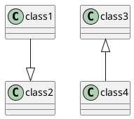

泛化（继承）用**实线 + 空心三角**表示，三角指向父类：`--|>` 表示左侧子类指向右侧父类，`<|--` 表示右侧子类指向左侧父类。

### 方案

**目标：** 仅“导出/渲染”路径——读取 VP 中的泛化关系，在类图中渲染为“实线 + 目标端空心三角”的 `--|>` / `<|--`。**不涉及导入。**

**现状分析（已核对源码）：**
- 渲染基础已具备：`PumlDiagram.writeEdge(PumlEdgeEnd, PumlEdgeEnd, LineStyle, String name, NameDirection direction)`（src/.../outputmodel/PumlDiagram.java，#9 已完成）的 `LineStyle.SOLID("--")` 与 `PumlEdgeEnd.ShapeKind`（`TRIANGLE("|>")`、`REVERSE_TRIANGLE("<|")`）已存在（src/.../outputmodel/PumlEdgeEnd.java），二者组合即可生成空心三角连线。
- 新输出模型中目前**没有**泛化的模型类、`MyElementType` 或导出器：`PumlElementExporterFactory`（src/.../outputmodel/pumelementexporter/PumlElementExporterFactory.java）目前注册了 ASSOCIATION / CLASS / PACKAGE / MODEL / RELATIONSHIPS / USE_CASE / UNIMPLEMENTED_ELEMENT，未含泛化。
- 旧 `MyRelationship_old.toExportFormat()`（src/.../myuml_old/mycommon_old/MyRelationship_old.java）有 `Generalization → <|--` 分支，但属于旧导出路径，不被新流水线消费，需要在新架构补齐。

**设计图（泛化导出相关模块）：**

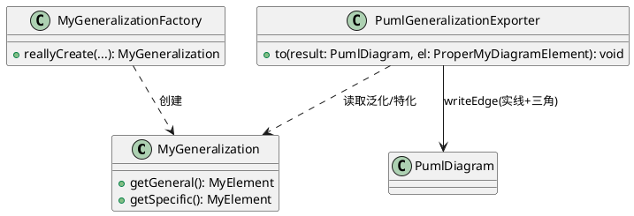

**实施步骤（每步可独立验证）：**

1. **建模（领域模型层）。**
   - 方案：新建 `MyGeneralization extends MyElement`，持有 general / specific（各为一个 `MyElement`），并提供 `getGeneral()` / `getSpecific()`（以及对应的 setter）。在 `MyElementType`（.../myuml/myelement/MyElementType.java）新增 `GENERALIZATION(MODEL_TYPE_GENERALIZATION, ".generalization")` 枚举项。
   - 理由：泛化在 UML 语义上不同于关联/依赖，独立建模便于后续导入与发展；字段命名用 UML 规范术语 `general`（一般/父类）/ `specific`（特化/子类），**避免使用 `parent`/`child`**，以免与 VP API 的 parent/child 语义混淆。
   - 验证：为 `MyGeneralization` 及工厂写基础单元测试（构造、getter、类型后缀）。

2. **读取（工厂/访问器）。**
   - 方案：新建 `MyGeneralizationFactory`（参考 `MyDependencyFactory`，src/.../mydependency/），用 `(IGeneralization) vpElement` 强转，再经 `((IRelationship) vpGeneralization).getFrom()/getTo()` 获取两个端点。
   - **方向判定研究结论（已核验）：** `IGeneralization` 无专属方向方法（javap 确认），只继承 `ISimpleRelationship → IRelationship` 的 `getFrom()/getTo()`。旧 `MyRelationship_old.toExportFormat()` 的 Generalization 分支固定输出 `source <|-- target`（`source = relationship.getFrom()`，三角在 getFrom 侧/左），而 PlantUML 中 `<|--` 的空心三角指向父类，因此 **VP 泛化的 `getFrom()`=父类(general)、`getTo()`=子类(specific)**。方向恒定，**只有 getGeneral→general、getSpecific→specific 一种映射，无需考虑正向/反向交换**（PlantUML 的 `--|>` 与 `<|--` 语义等价，均三角指父，统一渲染为其中一种即可）。
   - 说明：VP SDK 的 `IGeneralization` 已由 javap 确认存在且继承链含 `getFrom()/getTo()`（openapi.jar）。
   - 验证：用桩数据断言 `getGeneral()`/`getSpecific()` 正确提取。

3. **导出渲染（输出模型层）。**
   - 方案：新建 `PumlGeneralizationExporter`，`to(...)` 中把 general 放 from、specific 放 to，调用 `writeEdge` 生成实线（`LineStyle.SOLID`）+ **from 端 `REVERSE_TRIANGLE("<|")`**，输出 `general <|-- specific`（三角指向父类）。
   - **方向判定逻辑：** 依据上述研究结论，`getGeneral()` 恒放连接线左端、`getSpecific()` 恒放右端，三角固定在 general（父）端，即始终渲染为 `父 <|-- 子`。**恒只有这一种方向，不需要根据几何/绘制方向做正反向交换**（PlantUML 中 `--|>` 与 `<|--` 语义等价，都表示左侧父右侧子或反之，三角恒指父；统一输出 `<|--` 即可完整表达继承关系）。
   - 理由：与关联渲染复用同一 `writeEdge` 端点机制（role/multiplicity 标签、方向符号），风格统一。
   - 验证：为导出器写单元测试，断言 `父 <|-- 子`（general=父放 from、specific=子放 to），并覆盖需求中两种输入（VP from=父/to=子 与 from=子/to=父 均归一为 `父 <|-- 子`）与需求和 VP 中方向一致。

4. **注册与接线（工厂）——三处登记，缺一不可。**
   - 方案：
     - 元素工厂：在 `MyElementFactoryFactory`（.../myuml/myelement/MyElementFactoryFactory.java）构造器注入 `MyGeneralizationFactory` 并 `register(MyElementType.GENERALIZATION, myGeneralizationFactory)`。
     - 图元类型：在 `DiagramElementType`（.../mydiagram/mydiagramelement/DiagramElementType.java）新增 `GENERALIZATION(SHAPE_TYPE_GENERALIZATION, Kind.EDGE)`（`SHAPE_TYPE_GENERALIZATION` 属于 `IShapeTypeConstants`，javap 已确认存在）。
     - 输出导出器：在 `PumlElementExporterFactory`（.../outputmodel/pumelementexporter/PumlElementExporterFactory.java）构造器注入 `PumlGeneralizationExporter` 并 `register(MyElementType.GENERALIZATION, generalizationExporter)`。
   - 验证：`MyElementFactoryFactory`/`PumlElementExporterFactory` 相关测试验证可 `of(GENERALIZATION)` 取到工厂/导出器（而非回退 Unimplemented / 抛 BugException）；整体 `mvn test` 无回归。

5. **集成验证。**
   - 验证：手动在 VP 中建立若干继承关系导出，检查 `.puml` 渲染为 `--|>` / `<|--` 且三角指向父类；用 PlantUML 预览确认可读、方向正确。

**说明/边界：** 本条目不在导入流水线解析 `--|>`；`MyElementType.GENERALIZATION` 仅为导出而增设。若同一泛化在线两端带泛型/立体类型，与 #18/#19 的关系需在后续条目统一处理（此处先不做）。

## 12 接口实现 Implementation (棒棒糖方式)
- 状态：待编码
### 需求

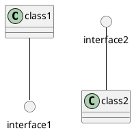

接口通过“棒棒糖（lollipop）”表示：接口渲染为一个小圆（`circle`），再用**实线**把它接到实现类上。

### 方案

**目标：** 仅“导出/渲染”路径——读取 VP 中“类实现接口”的关系，将接口渲染为 `circle`，并用实线连接到实现类。**不涉及导入。**

**现状分析（已核对源码）：**
- 输出模型层已有渲染“终端形状”的能力：`PumlDiagram.writeTerminalShape(String)`（src/.../outputmodel/PumlDiagram.java:51）可输出任意一段图元文本（如 `circle interface1`）。
- `PumlDiagram.writeEdge(PumlEdgeEnd, PumlEdgeEnd, LineStyle, String name, NameDirection direction)` 的 `LineStyle.SOLID("--")` 已具备实线能力（#9 已完成）。
- 新输出模型中没有任何“实现/接口关系”的模型类与导出器注册（见 #11 现状分析第 2 点）。

**设计图（棒棒糖导出相关模块）：**

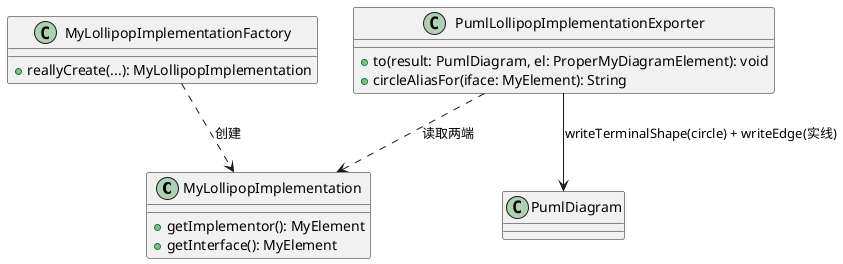

**实施步骤（每步可独立验证）：**

1. **建模（领域模型层）。**
   - 方案：新建 `MyLollipopImplementation extends MyElement`，持有 implementor / interfaceElement（各为一个 `MyElement`）。在 `MyElementType` 新增 `IMPLEMENTATION`（或复用已计划的关系容器类型）枚举项。
   - 理由：棒棒糖实现与常规实现（#20 `..|>`）在渲染上是两种不同形态，需能区分；但其底层关系又同为“实现”，建模时视 VP 关系类型决定是否与 #20 共用一个模型类（研究项）。
   - 验证：为模型及工厂写基础单元测试。

2. **读取（工厂/访问器）。**
   - 方案：新建 `MyLollipopImplementationFactory`（参考 `MyAssociationFactory`），从 VP 读取实现类与接口元素。
   - 验证：用桩数据断言 implementor / interface 正确提取。

3. **渲染（输出模型层）。**
   - 方案：新建 `PumlLollipopImplementationExporter`，`to(...)`：
     - 用 `writeTerminalShape("circle \"<接口名>\" as <别名>")` 输出棒棒糖小圆；
     - 用 `writeEdge(<实现类别名>, <接口圆别名>)` 以实线连接实现类与小圆。
   - 理由：`circle` 独立为一个形状，之后用实线把它挂到实现类上，正好还原 VP 的棒棒糖语义；复用 `writeTerminalShape` 不必为 circle 单独建导出器。
   - 验证：为导出器写单元测试，断言输出包含 `circle ...` 行与 `实现类 -- 接口圆` 实线行；`interface2 -- class2` 形式通过交换 from/to 得到。

4. **接线与去重（渲染编排）。**
   - 方案：多个类实现同一接口时，只为该接口输出**一个** `circle`，被多个实现类实线共用；需在渲染编排层保证 circle 声明不重复（可在导出器/容器中做去重，参考现有 package/class 渲染的去重策略）。
   - 理由：PlantUML 中以别名复用圆即可实现一对一棒棒糖语义；重复声明会导致歧义。
   - 验证：构造“两个类实现同一接口”的桩数据，断言只输出一行 `circle` 且两条实线分别指向同一别名。

5. **注册、回归与集成验证。**
   - 方案：在 `PumlElementExporterFactory` 注册 `IMPLEMENTATION` 导出器。
   - 验证：工厂单测验证 `of(IMPLEMENTATION)`；整体 `mvn test` 无回归；手动在 VP 中导出棒棒糖实现，确认 `.puml` 可被 PlantUML 正确渲染。

**说明/边界：** 本条目仅处理“棒棒糖”呈现形态；常规的 `..|>` 实现（如 Java `implements` 拉出来一条虚线三角）属 #20，两者在 VP 中可能表现同一种“实现”关系，最终统一成一个建模并向不同导出器分发（研究项）。本条目不涉及导入。

## 13 类的属性 Attribute
- 状态：待方案设计

### 需求

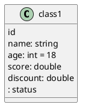
- 属性的名称、类型、可见性都可省略

### 方案
TODO

## 14 类的操作 Operation
- 状态：待方案设计

### 需求

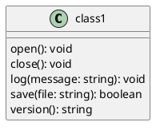

### 方案
TODO

## 15 可见性 Visibility
- 状态：待方案设计
- 注：通过前缀符号表示：`+` 公有、`-` 私有、`#` 保护、`~` 包级

### 需求

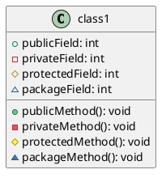

### 方案
TODO

## 16 类、包、接口的泛型 Stereotype
- 状态：待方案设计

### 需求

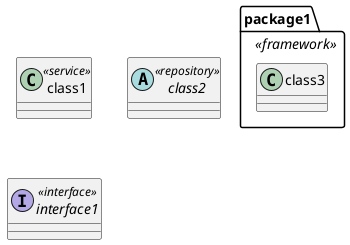

### 方案
TODO

## 17 关系的泛型 Stereotypes of Relationships
- 状态：待方案设计

### 需求

```plantuml
@startuml

class1 -- class2: name <<Stereotype1>> >
class3 -- class4: <<Stereotype2>> 
class5 ..> class6: <<Stereotype3>>
class7 <|-- class8: <<Stereotype4>>

@enduml
```

### 方案
TODO

## 18 接口实现 Implementation (常规方式)
- 状态：待方案设计

### 需求

```plantuml
@startuml
class class1 {}
class class2 {}

interface interface1 <<interface>> { }
interface interface2 <<interface>> {}

class1 ..|> interface1
interface2 <|.. class2

@enduml
```

### 方案
TODO

## 19 注释 Note

### 需求

用 `note` 为类、关系添加注释说明。

```plantuml
@startuml
class class1 {
}

note left of class1
  注释在类左侧
end note

note right of class1 : 也可写成单行注释

class1 -- class2
note on link
  注释挂在关系上
end note

@enduml
```

### 方案
TODO

## 20 枚举 Enumeration

### 需求

- `enum` 声明枚举，枚举值之间用逗号分隔,按UML的约定，应加 `<<enumeration>>` 关键字。

```plantuml
@startuml
enum Status <<enumeration>> {
    NEW
    ACTIVE
    CLOSED
}
@enduml
```

- 枚举也可以有属性和操作，如下例：
```plantuml
@startuml
enum Status <<enumeration>> {
    - name: string
    --
    + {static} valueOf(name: string): Status
    --
    NEW
    ACTIVE
    CLOSED
}
@enduml
```

### 方案
TODO
