# 类图 Class Diagram

## 1 包 package

- 状态：已完成

### 需求

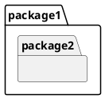
-注意： PlantUML 中的 "namespace" 才对应 UML package

### 方案
略

## 2 模型 Model

- 状态：已完成

### 需求

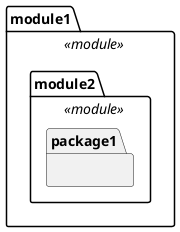

### 方案

略

## 3 类 Class

- 状态：已完成

### 需求

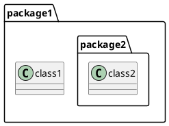

### 方案

略

## 4 关联 Association

- 状态：已完成

### 需求

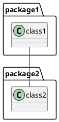

### 方案

略

## 5 多重性 Multiplicity

- 状态：已完成

### 需求

```plantuml
@startuml

namespace "package1" as package1{
class "class1" as package1__class1 {
}
}

namespace "package2" as package2 {
class "class2" as package2__class2 {
}
}

package1__class1 "1"--"0..1" package2__class2
package1__class1 "1"--"0..*" package2__class2
package1__class1 "*"--"1..*" package2__class2

@enduml
```

### 方案

略

## 6 导航 Navigation

- 状态：已完成

### 需求

```plantuml
@startuml
class1 "1"-->"0..1" class2
class3 "1"<--"0..*" class4
class5 "*"<-->"1..*" class6
class7 "*"x-->"1..*" class8
class9 "*"x--x"1..*" class10
class11 "*"--"1..*" class12
@enduml
```

### 方案

略

## 7 角色 Role

- 状态：已完成

### 需求

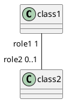

### 方案

略

## 8 聚合与组合 Aggregation & Composition

- 状态：已完成

### 需求

```plantuml
@startuml
class1 "1"*--"0..*" class2
class3 "1"o--"0..*" class4
@enduml
```
-注意： `*--` 表示组合（Composition），`o--` 表示聚合（Aggregation）

### 方案
略

## 9 关联名称 Association Name
- 状态：待方案设计

### 需求

```plantuml
@startuml
class1 "1"*--"0..*" class2: doSomething >
class3 "1"o--"0..*" class4: < doSomething
@enduml
```

### 方案
略

## 10 依赖 Dependency
- 状态：待方案设计

### 需求
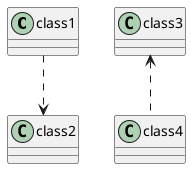

### 方案
TODO

## 11 泛化 Generalization
- 状态：待方案设计

### 需求
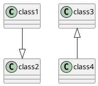

### 方案

TODO

## 12 接口实现 Implementation (棒棒糖方式)
- 状态：待方案设计
### 需求

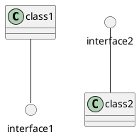

### 方案
TODO

## 13 类的属性 Attribute
- 状态：待编写需求

## 14 类的操作 Operation
- 状态：待编写需求

## 15 类、包、接口的泛型 Stereotype
- 状态：待编写需求

## 16 关系的泛型 Stereotypes of Relationships
- 状态：待方案设计

### 需求

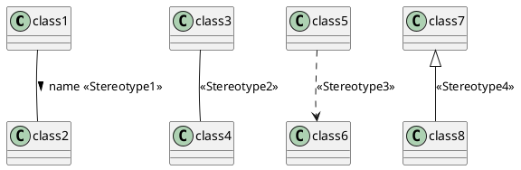

### 方案
TODO

## 17 接口实现 Implementation (常规方式)
- 状态：待方案设计

### 需求

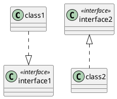

### 方案
TODO

## 18 抽象类 Abstract Class
- 状态：待方案设计

### 需求

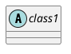

### 方案
TODO

## 19 抽象操作 Abstract Operation
- 注：在 plantuml 文档中称为抽象方法（abstract method）

## 20 静态操作和静态属性 Static Operation & Static Attribute
- 注意：在 plantuml 文档中操作(operation)称为方法（method），属性(attribute)成为字段（field）

## 21 限定关联 Qualified Associations

## 22 注释 Note

## 23 可见性 Visibility
- 状态：待编写需求
- 注：属性/操作最基础的特性，通过前缀符号表示：`+` 公有、`-` 私有、`#` 保护、`~` 包级

## 24 枚举 Enum
- 状态：待编写需求

## 25 泛型类 Generic Class
- 状态：待编写需求
- 注：如 `class Foo<T>`

## 26 关联类 Association Class
- 状态：待编写需求

## 27 嵌套类/内部类 Nested Class
- 状态：待编写需求

## 28 抛出异常 Exceptions
- 状态：待编写需求
