# 组件图 Component Diagram

## 1 组件 Component
- 状态：待方案设计

### 需求

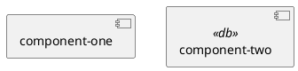

## 2 端口 Port
- 状态：待方案设计

### 需求

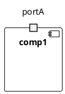
- 说明：端口（port）是组件边界上与外界交互的交互点，用组件边框上的小方块表示。端口通常作为提供接口或需求接口的连接点。

## 3 提供接口 Provided Interface (棒棒糖方式)
- 状态：待方案设计

### 需求

- 说明：组件向外提供服务的接口，用"棒棒糖"（lollipop，即圆+线段）表示，圆端为接口，线段连接组件。
- 以下是不经过端口的例子：
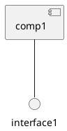

- 以下是经过端口的例子
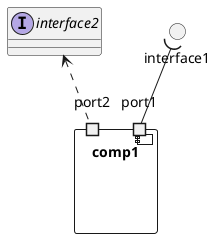

## 4 需求接口 Required Interface (棒棒糖方式)
- 状态：待方案设计

### 需求

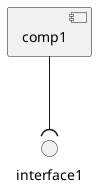
- 说明：组件运行时需要依赖其他组件提供的接口，用"半圆插座"（socket）形式挂在组件上表示需求接口。

## 5 接口 Interface (类方式)
- 状态：待方案设计

### 需求

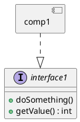
- 说明：接口也可以用类的方式（`interface` 关键字）表示，并可声明属性和操作，便于描述接口的业务契约。

## 6 依赖 Dependency
- 状态：待方案设计

### 需求

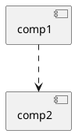
- 说明：一个组件在编译期或运行期依赖另一个组件，用虚线箭头表示依赖关系。

## 7 泛化 Generalization
- 状态：待方案设计

### 需求

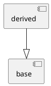
- 说明：一个组件泛化（继承）另一个组件，子组件继承父组件的结构和契约，用空心三角实线表示。

## 8 装配连接 Assembly Connector
- 状态：待方案设计

### 需求

- 说明：装配连接（assembly connector）把一个组件提供的接口通过端口与另一个组件需求的接口连接起来，描述组件之间的运行期协作。

 
- 不经端口
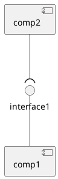

- 经端口
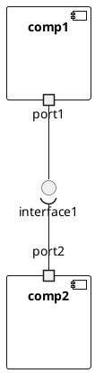
## 10 委托连接 Delegation Connector
- 状态：待方案设计

### 需求

- 说明：委托连接（delegation connector）把组件的外部端口与组件内部部件（如内部组件）的端口连接起来，表示外部请求委托给内部结构处理。
 
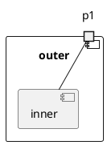

## 11 内部结构 / 部件 / 子组件 Inner Structure, Part & Nested Component
- 状态：待方案设计

### 需求

- 说明：组件可以拥有内部结构，包含若干部件（part，即内部组件/子组件）；部件还可以继续嵌套子组件，形成层级结构。
 
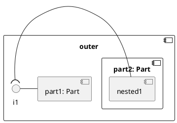

## 12 制品 Artifact
- 状态：待方案设计
- 说明：制品（artifact）是组件的物理实现物，如 jar 包、源文件、可执行文件等，用带右上角折叠角的矩形表示，通常被组件的实现所依赖。

### 需求

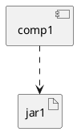

## 14 包 Package
- 状态：待方案设计

### 需求
- 说明：包（package）用于组织和管理组件，将相关的组件聚合在一起，可嵌套子包。

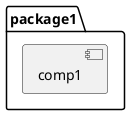

## 16 泛型 Stereotype
- 状态：待方案设计

### 需求
- 说明：组件、接口以及它们之间的关系都可以添加构造型（stereotype），用于扩展 UML 语义，如 `<<service>>`、`<<api>>`、`<<use>>`。

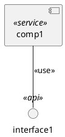

## 17 注释 Note
- 状态：待方案设计

### 需求

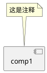
- 说明：注释（note）用于在图上附加说明文字，可挂接在任意元素上，帮助理解设计意图。
