# 顺序图 Sequence Diagram

## 1 生命线和类目 Lifeline & Classifier
- 状态：需求已编写

### 需求
- 说明：
  - 顺序图中的对象称为生命线（Lifeline）。在 PlantUML 中可声明为 `participant`、`actor` 
  - 类目（Classifier）指生命线所对应的类，用 `:Class` 或 `object :Class`表示。
  - 冒号前是对象名，冒号后是类目名，冒号前后的部分可分别省略，但不可同时省略。

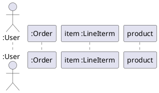

## 2 消息 Message (同步 / 异步)
- 状态：需求已编写

### 需求
- 说明：实心箭头 `->` 表示同步消息，开放箭头 `->>` 表示异步消息。

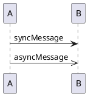

## 3 返回消息 Reply Message
- 状态：需求已编写

### 需求

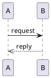

- 说明：返回消息（Reply）使用虚线箭头 `-->`，对应代码中 `MessageData.isReply`。

## 4 创建消息 Create Message
- 状态：需求已编写

### 需求

- 说明：创建消息使用 `create` 关键字声明被创建的生命线，对应代码中 `IMessage.TYPE_CREATE_MESSAGE`。
 
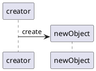

## 5 销毁消息 Destroy Message
- 状态：需求已编写

### 需求

- 在消息后的下一句加 `destroy 接收方` 语句，表示向接收方发送销毁消息
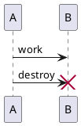

- 在消息后的下一句加 `destroy 发送方` 语句，表示发送方发送消息后销毁自身
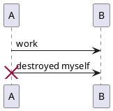

## 6 递归消息 Self / Recursive Message
- 状态：需求已编写

### 需求
- 说明：消息的源与目标为同一生命线时为递归（自调用）消息，对应代码中 `IMessage.TYPE_RECURSIVE_MESSAGE`。
 
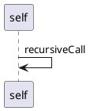

## 7 入向和出向消息 Incoming & Outcoming Message
- 状态：需求已编写

### 需求

- 说明：`[o` 表示消息来自外部（入向），`o]` 表示消息发往外部（出向）
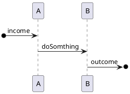

## 8 激活与撤销激活 Activation & Deactivation
- 状态：需求已编写

### 需求

- 说明：发送消息后，用 `activate` 表示在此处激活目标生命线，用 `deactive` 表示撤销激活。
 
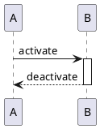

## 9 序号 Sequence Number
- 状态：需求已编写

### 需求

- 说明：消息可带序号（Sequence Number），用于标注消息次序。图例以 PlantUML 的 `autonumber` 示意。
 
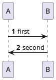

## 10 alt组合框 Alternative Frame
- 状态：需求已编写

### 需求
- `alt`（Alternative）表示多分支互斥选择，多个操作数之间用 `else` 分隔，对应代码中对 `alt` 类型的处理。

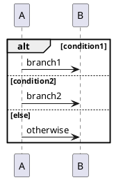

## 11 opt组合框 Optional Frame
- 状态：需求已编写

### 需求
- 说明：`opt`（Optional）表示可选的单一分支，对应代码中对 `opt` 类型的处理。

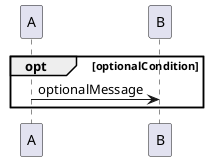

## 12 loop组合框 Loop Frame
- 状态：需求已编写

### 需求
- 说明：`loop`（Loop）表示循环执行。

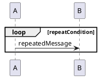

## 13 par组合框 Parallel Frame
- 状态：需求已编写

### 需求
- 说明：`par`（Parallel）表示并发执行的多个操作数，操作数之间用 `else` 分隔。

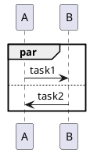

## 14 break组合框 Break Frame
- 状态：需求已编写

### 需求
- 说明：`break`（Break）表示异常/中断分支，对应代码中对 `break` 类型的处理。
 
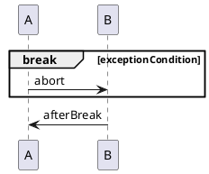

## 15 critical组合框 Critical Frame
- 状态：需求已编写

### 需求
- 说明：`critical`（Critical）表示临界区，其中消息应原子执行。

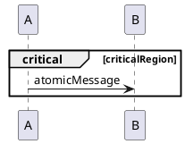

## 16 ref 组合框 Interaction Reference Frame
- 状态：需求已编写
- 说明：交互引用（Interaction Reference）用 `ref over 生命线 : 名称` 表示对另一个交互的引用。

### 需求

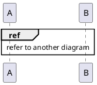

## 17 注释 Note
- 状态：需求已编写

### 需求
- 说明：注释（Note）可附着于某个生命线、覆盖多个生命线或位于对象右侧，对应代码中 `MyNote_old` 的处理。

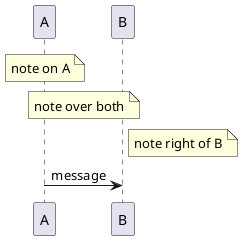

## 18 泛型 Stereotype
- 状态：需求已编写

### 需求
- 说明：生命线与参与者可以带有泛型（Stereotype），例如 `control`、`entity`、`boundary` 或自定义构型。

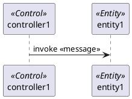

