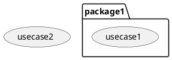
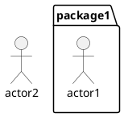
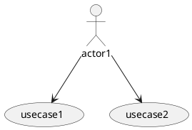

# 用例图 Use Case Diagram

## 1 用例和包 Use Case & Package
- 状态：已完成

### 需求

## 方案
略

## 2 执行者 Actor
- 状态：待设计

### 需求

### 方案
TODO

## 3 执行者和用例关联
- 状态：待设计

### 需求

### 方案
TODO

## 4 泛化 Generalization
- 状态：待编写需求

## 5 包含 Include
- 状态：待编写需求

## 6 扩展 Extend
- 状态：待编写需求

## 7 依赖 Dependence
- 状态：待编写需求

## 8 子系统 Subsystem
- 状态：待编写需求

## 9 注释 Note
- 状态：待编写需求

## 10 扩展点 Extension Point
- 状态：待编写需求

## 11 约束 Constraint
- 状态：待编写需求
