# 用例图 Use Case Diagram

## 1 用例和包 Use Case & Package
- 状态：已完成

### 需求

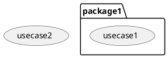

## 方案
略

## 2 执行者 Actor
- 状态：待设计

### 需求

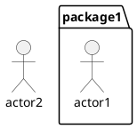

### 方案
TODO

## 3 执行者和用例关联
- 状态：待设计

### 需求

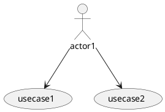

### 方案
TODO

## 4 泛化 Generalization
- 状态：待编写需求

### 需求

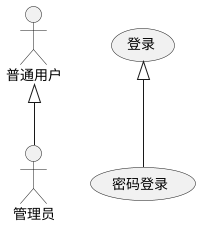

说明：泛化可作用于执行者之间（子执行者继承父执行者参与的用例）或用例之间（子用例继承父用例的行为），用空心三角箭头表示，子指向父。

## 5 包含 Include
- 状态：待编写需求

### 需求

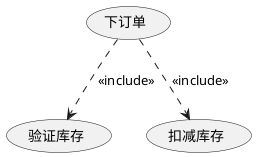

说明：include 表示基础用例在执行时必定会包含被包含用例的行为，箭头从基础用例指向被包含用例，标注 `<<include>>` 构造型（虚线依赖）。

## 6 扩展 Extend
- 状态：待编写需求

### 需求

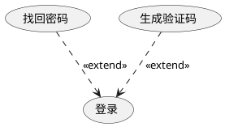

说明：extend 表示扩展用例在满足一定条件时才会加入到基础用例中，箭头从扩展用例指向基础用例，标注 `<<extend>>` 构造型（虚线依赖）。

## 7 依赖 Dependence
- 状态：待编写需求

### 需求

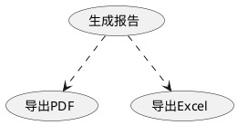

说明：普通的依赖关系用带箭头的虚线表示，表示一个用例以某种方式依赖于另一个用例，但不带 `<<include>>`/`<<extend>>` 等构造型。

## 8 主题 Subject
- 状态：待编写需求

### 需求
- UML中用术语 Subject 表示系统或子系统边界  

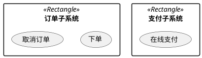

说明：子系统用 `package` + `<<subsystem>>` 构造型表示，用于对用例图元素进行分组。

## 9 注释 Note
- 状态：待编写需求

### 需求

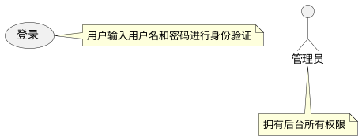

说明：注释（Note）用于补充说明单个元素，或通过 `note ... end note` 跨元素说明。

## 10 扩展点 Extension Point
- 状态：待编写需求

### 需求
- 方法一：文字说明
- 由于 PlantUML 对于 usecase ，as 既可以用于多行输出，也可以用于别名，两种用法冲突，因此下面用注释表示，一边保留全局唯一别名。
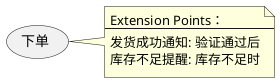

方法二：利用扩展依赖，同时注明扩展条件
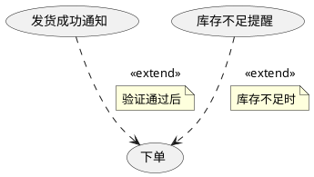

说明：扩展点位于基础用例内部，标识出哪些位置可能被扩展用例插入。上面的图用注释列出扩展点，并通过 `<<extend>>` 表示对应扩展关系。
